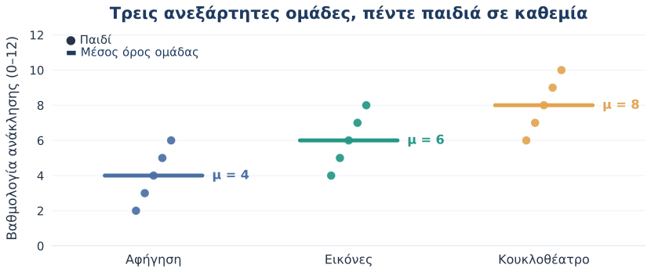
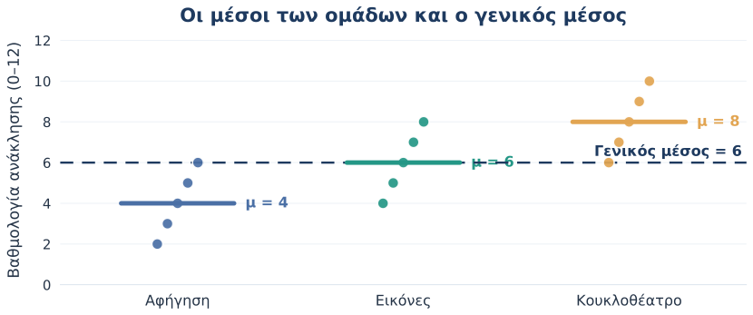
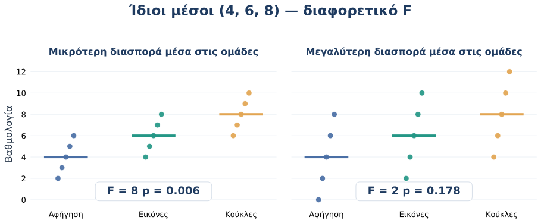
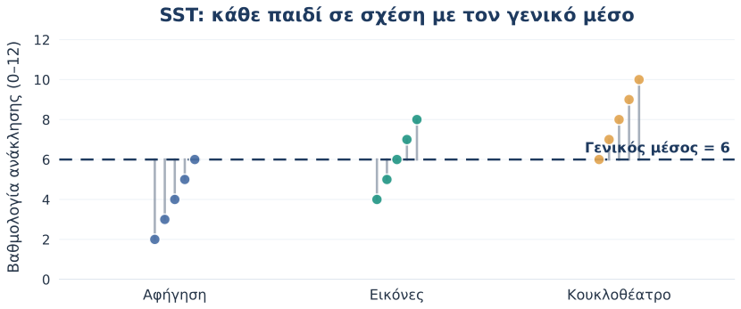
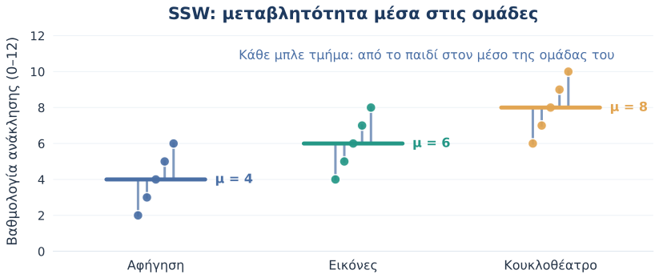
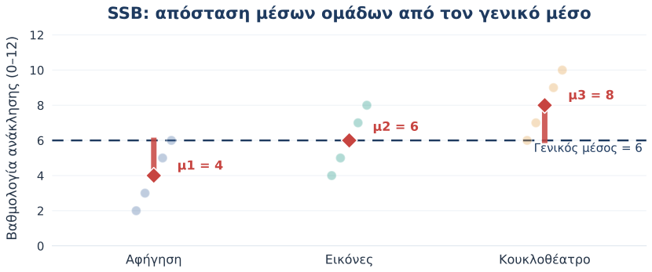
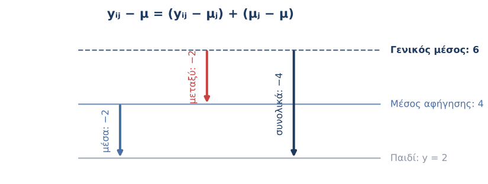
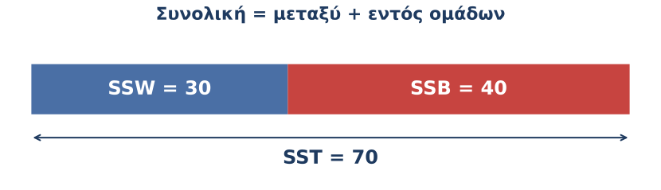
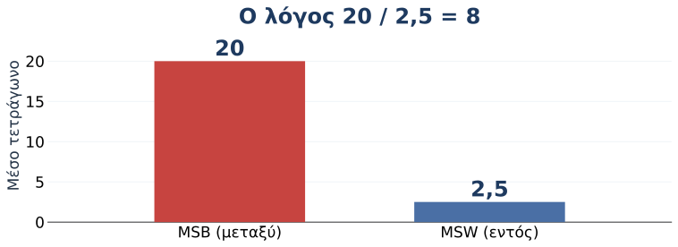
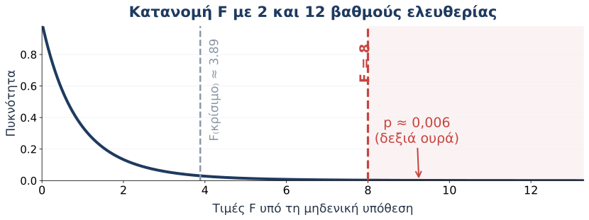

# Το ερευνητικό ερώτημα

## Η μελέτη

Έπειτα από μια δραστηριότητα, ζητάμε από κάθε παιδί να ανακαλέσει λέξεις από μια ιστορία.

::: {.columns}
::: {.column width="60%"}
**Τρεις τρόποι παρουσίασης της ιστορίας**

- **Α:** Προφορική αφήγηση
- **Β:** Αφήγηση με εικόνες
- **Γ:** Κουκλοθέατρο

**Έκβαση:** αριθμός λέξεων που ανακλήθηκαν (0–12).
:::
::: {.column width="40%"}
::: {.mini-card}
**Ερευνητικό ερώτημα**

Διαφέρει ο μέσος αριθμός λέξεων που θυμούνται τα παιδιά ανάλογα με τον τρόπο παρουσίασης;
:::
:::
:::

Υποθετικά δεδομένα για διδασκαλία· 15 διαφορετικά παιδιά, κατανεμημένα σε τρεις ανεξάρτητες ομάδες.

## Γιατί δεν αρκεί ένα t-test;

- Το **t-test** συγκρίνει συνήθως **δύο** μέσους.
- Εδώ έχουμε **τρεις ανεξάρτητες ομάδες**.

::: {.takeaway}
**Ένας παράγοντας:** τρόπος παρουσίασης (Α, Β, Γ). 
**Μία εξαρτημένη μεταβλητή:** #λέξεων που ανακλήθηκαν.
:::

## Τα δεδομένα {auto-animate="false"}

| Παιδί           | Α: Αφήγηση | Β: Εικόνες | Γ: Κουκλοθέατρο |
|:----------------|-----------:|-----------:|----------------:|
| 1               |          2 |          4 |               6 |
| 2               |          3 |          5 |               7 |
| 3               |          4 |          6 |               8 |
| 4               |          5 |          7 |               9 |
| 5               |          6 |          8 |              10 |
| **Μέσος όρος** |      **4** |      **6** |           **8** |

## Πρώτα κοιτάμε τα παιδιά, όχι μόνο τους μέσους

{.plot width="96%"}

::: {.takeaway}
**Σκεφτείτε:**  
Είναι η διαφορά ανάμεσα στις ομάδες μεγάλη, αν λάβουμε συνεκτιμήσουμε και την 
:::

## Μέσοι όροι

{.plot width="95%"}

$$
\bar y_A=4,\qquad \bar y_B=6,\qquad \bar y_\Gamma=8,\qquad \bar y=6
$$

## Υποθέσεις

::: {.columns}
::: {.column width="50%"}
::: {.mini-card}
**Μηδενική υπόθεση ($H_0$)**

$$\mu_A=\mu_B=\mu_\Gamma$$

Στον πληθυσμό, οι τρεις μέσοι είναι ίσοι.
:::
:::
::: {.column width="50%"}
::: {.mini-card}
**Εναλλακτική υπόθεση ($H_1$)**

Δεν είναι όλοι οι μέσοι ίσοι.

Τουλάχιστον ένας πληθυσμιακός μέσος διαφέρει από κάποιον άλλο.
:::
:::
:::

## Η διαφορά μέσων από μόνη της δεν αρκεί

{.plot width="97%"}

**Ίδιοι μέσοι όροι (4, 6, 8)**,  
αλλά η δεύτερη εικόνα έχει πολύ μεγαλύτερη διασπορά μέσα στις ομάδες.

# Ανάλυση της διασποράς

## Συμβολισμοί

::: {.three-terms}
::: {.term}
$y_{ij}$

Η επίδοση του **παιδιού $i$** στην **ομάδα $j$**.
:::
::: {.term}
$\bar y_j$

Ο **μέσος της ομάδας $j$**.
:::
::: {.term}
$\bar y$

Ο **γενικός μέσος** όλων των παιδιών.
:::
:::

::: {.takeaway}
**ΣΗΜΑΝΤΙΚΟ**  
Η ANOVA χωρίζει τη συνολική μεταβλητότητα σε μεταβλητότητα **μεταξύ ομάδων** και **μέσα στις ομάδες**.
:::

## Συνολική μεταβλητότητα: SST

{.plot width="94%"}

$$
SS_T=\sum_{j=1}^{k}\sum_{i=1}^{n_j}(y_{ij}-\bar y)^2
$$

## Μεταβλητότητα μέσα στις ομάδες: SSW

{.plot width="94%"}

$$
SS_W=\sum_{j=1}^{k}\sum_{i=1}^{n_j}(y_{ij}-\bar y_j)^2
$$

Πόσο διαφέρουν τα παιδιά από τον μέσο της <em>δικής τους</em> ομάδας;

## Μεταβλητότητα μεταξύ ομάδων: SSB

{.plot width="94%"}

$$
SS_B=\sum_{j=1}^{k}n_j(\bar y_j-\bar y)^2
$$

Πόσο απέχει ο μέσος κάθε ομάδας από τον γενικό μέσο; Κάθε ομάδα συνεισφέρει ανάλογα με το μέγεθός της.

## Ανάλυση αποστάσεων

{.plot width="95%"}

$$
\underbrace{(y_{ij}-\bar y)}_{\text{συνολικά}}
=\underbrace{(y_{ij}-\bar y_j)}_{\text{μέσα στην ομάδα}}
+\underbrace{(\bar y_j-\bar y)}_{\text{μεταξύ ομάδων}}
$$

## Βασική εξίσωση της ANOVA

::: {.hero-equation}
$$
\boxed{SS_T=SS_B+SS_W}
$$
:::

::: {.columns}
::: {.column width="50%"}
::: {.mini-card .between-card}
**SSB: Μεταξύ ομάδων**

Διαφορές των μέσων των ομάδων από τον γενικό μέσο.
:::
:::
::: {.column width="50%"}
::: {.mini-card .within-card}
**SSW: Μέσα στις ομάδες**

Διαφορές των ατομικών επιδόσεων από τον μέσο κάθε ομάδας.
:::
:::
:::

## Το υπολογίζουμε με τα 15 παιδιά μας

| Ποσότητα                    | Ομάδα Α | Ομάδα Β | Ομάδα Γ |         **Σύνολο** |
|:----------------------------|--------:|--------:|--------:|-------------------:|
| $n_j$                       |       5 |       5 |       5 |             **15** |
| $\bar y_j$                  |       4 |       6 |       8 | **6** (γενικός μ.) |
| $\sum_i(y_{ij}-\bar y_j)^2$ |      10 |      10 |      10 |       **SSW = 30** |
| $n_j(\bar y_j-\bar y)^2$    |      20 |       0 |      20 |       **SSB = 40** |

$$
SS_T=SS_B+SS_W=40+30=\boxed{70}
$$

## Βλέπουμε την αποσύνθεση με μία ματιά

{.plot width="95%"}

::: {.takeaway}
Η συνολική μεταβλητότητα **70** μονάδων² αποτελείται από **40** μονάδες² μεταξύ ομάδων και **30** μονάδες² μέσα στις ομάδες.
:::

# Το στατιστικό F

## Απλή σύγκριση δεν αρκεί

Τα αθροίσματα τετραγώνων (SS) εξαρτώνται από το πόσες ομάδες και πόσα παιδιά έχουμε. Χρειάζεται προσαρμογή για τους **βαθμούς ελευθερίας**.

| Πηγή μεταβλητότητας | Βαθμοί ελευθερίας | Παράδειγμα |
|:--------------------|:-----------------:|-----------:|
| Μεταξύ ομάδων       |    $df_B=k-1$     |    $3-1=2$ |
| Μέσα στις ομάδες    |    $df_W=N-k$     |  $15-3=12$ |
| Συνολικά            |    $df_T=N-1$     |  $15-1=14$ |

$k$: αριθμός ομάδων · $N$: συνολικός αριθμός παιδιών.

## Τα μέσα τετράγωνα (Mean Squares)

$$
MS_B=\frac{SS_B}{df_B}=\frac{40}{2}=\boxed{20}
$$

$$
MS_W=\frac{SS_W}{df_W}=\frac{30}{12}=\boxed{2{,}5}
$$

::: {.takeaway}
**ΣΗΜΑΝΤΙΚΟ**  
Τα μέσα τετράγωνα εκφράζουν τη μεταβλητότητα ανά αντίστοιχο βαθμό ελευθερίας.  
Το $MS_W$ χρησιμοποιείται ως εκτίμηση της διακύμανσης του σφάλματος.
:::

## Το  στατιστικό F

{.plot width="78%"}

::: {.hero-equation}
$$
F=\frac{MS_B}{MS_W}=\frac{40/2}{30/12}=\frac{20}{2{,}5}=\boxed{8}
$$
:::

## Ερμηνεία του στατιστικού F

::: {.columns}
::: {.column width="50%"}
::: {.mini-card}
**$F$ κοντά στο 1**

Η μεταβλητότητα **μεταξύ** των ομάδων είναι ανάλογη με τη μεταβλητότητα **μέσα** στις ομάδες.

Οι διαφορές των μέσων μπορεί να οφείλονται σε τυχαία δειγματοληπτική διακύμανση.
:::
:::
::: {.column width="50%"}
::: {.mini-card}
**Μεγάλο $F$**

Η μεταβλητότητα **μεταξύ** των ομάδων είναι μεγάλη συγκριτικά με τη μεταβλητότητα **μέσα** στις ομάδες.

Περισσότερα ενδείξεις **κατά** της $H_0$.
:::
:::
:::

::: {.takeaway}
**ΣΗΜΑΝΤΙΚΟ**  

- Το F δεν γίνεται αρνητικό.
- Το αν μία τιμή του F είναι μεγάλη ή μικρή εξαρτάται από τους βαθμούς ελευθερίας.

:::

## Ερμηνεία του στατιστικού F

{.plot width="95%"}

::: {.discussion}
**Ερώτηση:** Όταν μεγαλώνει μόνο το $MS_W$ ενώ το $MS_B$ μένει ίδιο, τι συμβαίνει στο $F$;
:::

**Απάντηση:** Το $F$ μικραίνει. Στο παράδειγμα από $8$ γίνεται $2$.

# Στατιστική συμπερασματολογία

## Κατανομή του F

Υπό τη **μηδενική υπόθεση** και τις παραδοχές της ANOVA:

$$
F\sim F(df_B,df_W) = F(2,12)
$$

{.plot width="76%"}

Για το παράδειγμά μας: $F=8$, $p\approx0{,}0062$· η τιμή $p$ είναι το εμβαδόν της δεξιάς ουράς πέρα από το παρατηρημένο F, εφόσον ισχύει η $H_0$.

## Ο πίνακας ANOVA

| Πηγή             | SS | df |   MS |        F |         p |
|:-----------------|---:|---:|-----:|---------:|----------:|
| Μεταξύ ομάδων    | 40 |  2 |   20 | **8,00** | **0,006** |
| Μέσα στις ομάδες | 30 | 12 | 2,50 |        — |         — |
| Σύνολο           | 70 | 14 |    — |        — |         — |

::: {.takeaway}
**ΑΠΟΦΑΣΗ**  

- Εφόσον $p=0{,}006<0{,}05$, **απορρίπτουμε την $H_0$**.
- Υπάρχουν ενδείξεις ότι δεν έχουν όλες οι ομάδες τον ίδιο πληθυσμιακό μέσο.
:::

## Παρουσίαση

::: {.reporting}
«Η μονοπαραγοντική ανάλυση διακύμανσης έδειξε στατιστικά σημαντική διαφορά στη μέση επίδοση ανάκλησης λέξεων μεταξύ των τριών τρόπων παρουσίασης της ιστορίας, **$F(2,12)=8{,}00$, $p=0{,}006$**.»
:::

## ΠΡΟΣΟΧΗ

Η ANOVA απαντά στο ερώτημα:

> **Υπάρχει τουλάχιστον μία διαφορά μεταξύ των πληθυσμιακών μέσων;**

**Δεν μας απαντά ποια/ες ομάδες διαφέρουν.**

# Άσκηση

## Ερευνητικό σενάριο

- Μια ερευνητική ομάδα μελετά αν **ο τύπος μιας οργανωμένης δραστηριότητας** σχετίζεται με τη **συνεργατική συμπεριφορά παιδιών προσχολικής ηλικίας**. 
- Συμμετέχουν παιδιά που κατανέμονται τυχαία σε μία από τέσσερις δραστηριότητες: ελεύθερο παιχνίδι, κατασκευές, παιχνίδι ρόλων ή συνεργατικό παζλ. 
- Κάθε παιδί συμμετέχει **σε μία μόνο δραστηριότητα**.
- Μετά τη δραστηριότητα, ένας/μία παρατηρητής/τρια αποδίδει μία βαθμολογία συνεργασίας από **0 έως 40** με κοινή κλίμακα παρατήρησης.
- Οι υψηλότερες τιμές υποδηλώνουν μεγαλύτερη συνεργασία.

_Τα δεδομένα είναι **προσομοιωμένα** και δεν προέρχονται από πραγματικά παιδιά._

## Οι μεταβλητές

- `child_id`: κωδικός παιδιού
- `activity_type`: τύπος δραστηριότητας
- `cooperation_score`: βαθμολογία συνεργασίας (0–40)

## Ερωτήματα

1. Πόσα παιδιά ανήκουν σε κάθε δραστηριότητα; Είναι τα μεγέθη των ομάδων ίδια;
2. Υπολογίστε μέσο όρο και τυπική απόκλιση της βαθμολογίας συνεργασίας ανά ομάδα.
3. Κατασκευάστε ένα γράφημα που συγκρίνει τις ομάδες (π.χ. θηκόγραμμα). Τι παρατηρείτε;
4. Διατυπώστε τις **H₀** και **H₁** της ANOVA μίας κατεύθυνσης.
5. Εκτελέστε **ANOVA μίας κατεύθυνσης** με `cooperation_score` ως εξαρτημένη μεταβλητή και `activity_type` ως παράγοντα.
6. Αναφέρετε το **F**, τους βαθμούς ελευθερίας και το **p-value**. Ποιο είναι το συμπέρασμα στο επίπεδο α = 0,05;
