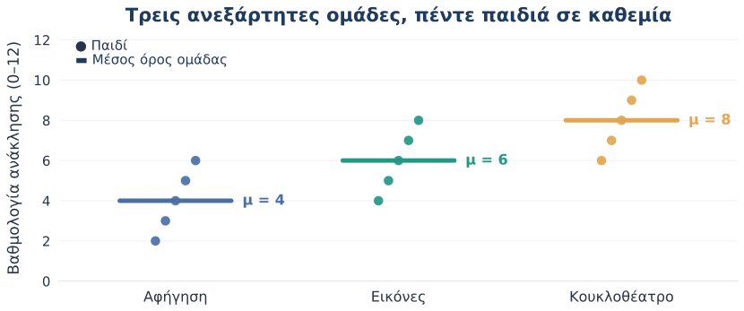
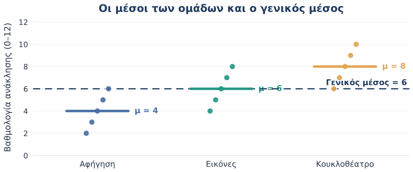
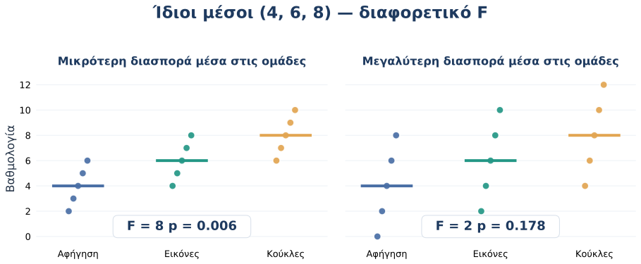
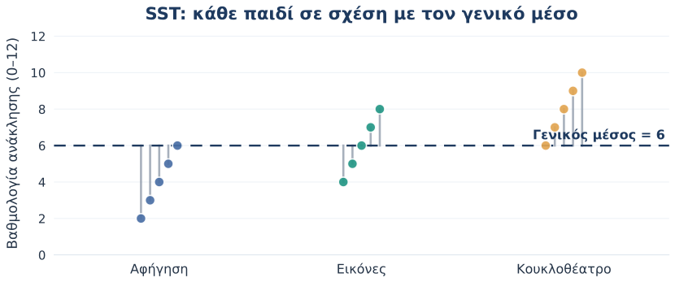
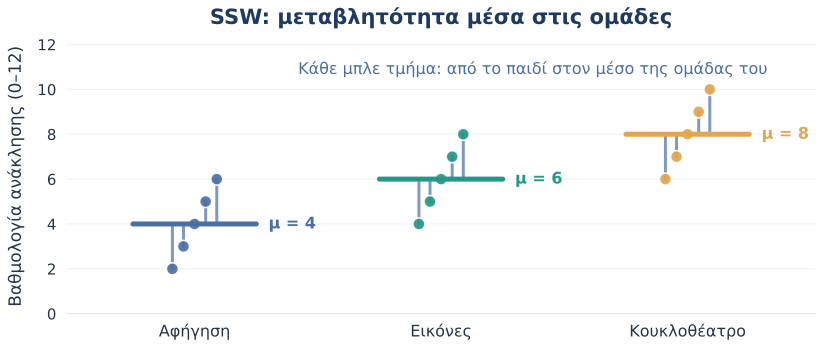
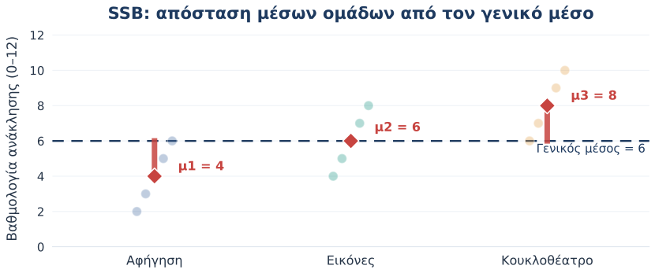
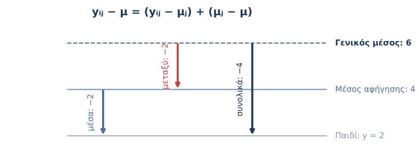
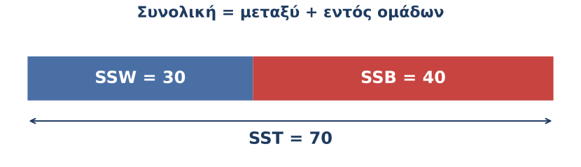
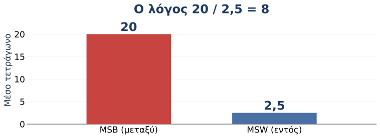
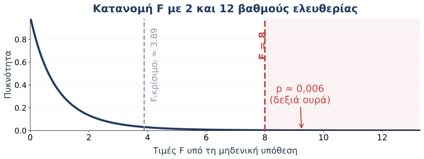

# Το ερευνητικό ερώτημα

## Τι θα μπορούμε να κάνουμε στο τέλος;

::: {.objectives}
1. Να ξεχωρίζουμε τη **διαφορά μεταξύ μέσων** από τη **μεταβλητότητα μέσα στις ομάδες**.
2. Να εξηγούμε γιατί $SS_T = SS_B + SS_W$.
3. Να κατασκευάζουμε τον λόγο **$F = MS_B/MS_W$**.
4. Να ερμηνεύουμε ένα αποτέλεσμα one-way ANOVA σε εκπαιδευτική έρευνα.
:::

::: {.takeaway}
**Κεντρική ερώτηση:** Είναι οι μέσοι όροι διαφορετικοί *σε σχέση με* τις διαφορές που υπάρχουν έτσι κι αλλιώς ανάμεσα στα παιδιά;
:::

## Μια μικρή έρευνα στο νηπιαγωγείο

Έπειτα από μια δραστηριότητα, ζητάμε από κάθε παιδί να ανακαλέσει λέξεις από μια ιστορία.

::: {.columns}
::: {.column width="60%"}
**Τρεις τρόποι παρουσίασης της ιστορίας**

- **Α** — Προφορική αφήγηση
- **Β** — Αφήγηση με εικόνες
- **Γ** — Κουκλοθέατρο

**Έκβαση:** αριθμός λέξεων που ανακλήθηκαν (0–12).
:::
::: {.column width="40%"}
::: {.mini-card}
**Ερευνητικό ερώτημα**

Διαφέρει ο μέσος αριθμός λέξεων που θυμούνται τα παιδιά ανάλογα με τον τρόπο παρουσίασης;
:::
:::
:::

Υποθετικά δεδομένα για διδασκαλία· 15 διαφορετικά παιδιά, κατανεμημένα σε τρεις ανεξάρτητες ομάδες.

## Γιατί δεν αρκεί ένα t-test;

- Το **t-test** συγκρίνει συνήθως **δύο** μέσους.
- Εδώ έχουμε **τρεις ανεξάρτητες ομάδες**.
- Η **one-way ANOVA** εξετάζει *ένα* παράγοντα με τρία επίπεδα σε **έναν συνολικό έλεγχο**.

::: {.takeaway}
**Ένας παράγοντας:** τρόπος παρουσίασης (Α, Β, Γ). 
**Μία εξαρτημένη μεταβλητή:** επίδοση ανάκλησης.
:::

## Τα δεδομένα μας {auto-animate="false"}

| Παιδί | Α: Αφήγηση | Β: Εικόνες | Γ: Κουκλοθέατρο |
|:--|--:|--:|--:|
| 1 | 2 | 4 | 6 |
| 2 | 3 | 5 | 7 |
| 3 | 4 | 6 | 8 |
| 4 | 5 | 7 | 9 |
| 5 | 6 | 8 | 10 |
| **Μέσος** | **4** | **6** | **8** |

Κάθε στήλη περιλαμβάνει διαφορετικά παιδιά· οι γραμμές δεν είναι ζευγαρωμένες παρατηρήσεις.

## Πρώτα κοιτάμε τα παιδιά, όχι μόνο τους μέσους

{.plot width="96%"}

::: {.discussion}
**Σκεφτείτε:** Είναι η διαφορά ανάμεσα στις ομάδες μεγάλη συγκριτικά με την ποικιλία επιδόσεων μέσα σε κάθε ομάδα;
:::

## Τρεις μέσοι και ένας γενικός μέσος

{.plot width="95%"}

$$
\bar y_A=4,\qquad \bar y_B=6,\qquad \bar y_\Gamma=8,\qquad \bar y=6
$$

## Ποιες υποθέσεις εξετάζουμε;

::: {.columns}
::: {.column width="50%"}
::: {.mini-card}
**Μηδενική υπόθεση ($H_0$)**

$$\mu_A=\mu_B=\mu_\Gamma$$

Στον πληθυσμό, οι τρεις μέσοι είναι ίσοι.
:::
:::
::: {.column width="50%"}
::: {.mini-card}
**Εναλλακτική υπόθεση ($H_1$)**

**Δεν είναι όλοι οι μέσοι ίσοι.**

Τουλάχιστον ένας πληθυσμιακός μέσος διαφέρει από κάποιον άλλο.
:::
:::
:::

Δεν εξετάζουμε με την omnibus ANOVA ποια συγκεκριμένα ζεύγη διαφέρουν.

## Η διαφορά μέσων από μόνη της δεν αρκεί

{.plot width="97%"}

**Ίδιοι μέσοι (4, 6, 8)** — αλλά η δεύτερη εικόνα έχει πολύ μεγαλύτερη μεταβλητότητα μέσα στις ομάδες.

# Πού βρίσκεται η μεταβλητότητα;

## Τρεις ποσότητες που πρέπει να ξεχωρίσουμε

::: {.three-terms}
::: {.term}
$y_{ij}$

Η επίδοση του **παιδιού $i$** στην **ομάδα $j$**.
:::
::: {.term}
$\bar y_j$

Ο **μέσος της ομάδας $j$**.
:::
::: {.term}
$\bar y$

Ο **γενικός μέσος** όλων των παιδιών.
:::
:::

::: {.takeaway}
Η ANOVA χωρίζει τη συνολική μεταβλητότητα σε μεταβλητότητα **μεταξύ ομάδων** και **μέσα στις ομάδες**.
:::

## Συνολική μεταβλητότητα: SST

{.plot width="94%"}

$$
SS_T=\sum_{j=1}^{k}\sum_{i=1}^{n_j}(y_{ij}-\bar y)^2
$$

Για κάθε παιδί: απόσταση από τον γενικό μέσο → τετράγωνο → άθροισμα.

## Μεταβλητότητα μέσα στις ομάδες: SSW

{.plot width="94%"}

$$
SS_W=\sum_{j=1}^{k}\sum_{i=1}^{n_j}(y_{ij}-\bar y_j)^2
$$

Πόσο διαφέρουν τα παιδιά από τον μέσο της <em>δικής τους</em> ομάδας;

## Μεταβλητότητα μεταξύ ομάδων: SSB

{.plot width="94%"}

$$
SS_B=\sum_{j=1}^{k}n_j(\bar y_j-\bar y)^2
$$

Πόσο απέχει ο μέσος κάθε ομάδας από τον γενικό μέσο; Κάθε ομάδα συνεισφέρει ανάλογα με το μέγεθός της.

## Η απόσταση κάθε παιδιού «σπάει» σε δύο μέρη

{.plot width="95%"}

$$
\underbrace{(y_{ij}-\bar y)}_{\text{συνολικά}}
=\underbrace{(y_{ij}-\bar y_j)}_{\text{μέσα στην ομάδα}}
+\underbrace{(\bar y_j-\bar y)}_{\text{μεταξύ ομάδων}}
$$

Παράδειγμα: παιδί με 2 λέξεις στην ομάδα Α, της οποίας ο μέσος είναι 4, ενώ ο γενικός μέσος είναι 6.

## Η μεγάλη ταυτότητα της ANOVA

::: {.hero-equation}
$$
\boxed{SS_T=SS_B+SS_W}
$$
:::

::: {.columns}
::: {.column width="50%"}
::: {.mini-card .between-card}
**SSB — Μεταξύ ομάδων**

Διαφορές των μέσων των ομάδων από τον γενικό μέσο.
:::
:::
::: {.column width="50%"}
::: {.mini-card .within-card}
**SSW — Μέσα στις ομάδες**

Διαφορές των ατομικών επιδόσεων από τον μέσο κάθε ομάδας.
:::
:::
:::

Η ισότητα αφορά <strong>αθροίσματα τετραγώνων</strong>, όχι γενικά τυπικές αποκλίσεις. Οι μικτοί όροι ακυρώνονται όταν αθροίσουμε ανά ομάδα.

## Το υπολογίζουμε με τα 15 παιδιά μας

| Ποσότητα | Ομάδα Α | Ομάδα Β | Ομάδα Γ | **Σύνολο** |
|:--|--:|--:|--:|--:|
| $n_j$ | 5 | 5 | 5 | **15** |
| $\bar y_j$ | 4 | 6 | 8 | **6** (γενικός μ.) |
| $\sum_i(y_{ij}-\bar y_j)^2$ | 10 | 10 | 10 | **SSW = 30** |
| $n_j(\bar y_j-\bar y)^2$ | 20 | 0 | 20 | **SSB = 40** |

$$
SS_T=SS_B+SS_W=40+30=\boxed{70}
$$

## Βλέπουμε την αποσύνθεση με μία ματιά

{.plot width="95%"}

::: {.takeaway}
Η συνολική μεταβλητότητα **70** μονάδων² αποτελείται από **40** μονάδες² μεταξύ ομάδων και **30** μονάδες² μέσα στις ομάδες.
:::

# Από τα αθροίσματα τετραγώνων στο F

## Γιατί δεν συγκρίνουμε απλώς 40 με 30;

Τα **SS** εξαρτώνται από το πόσες ομάδες και πόσα παιδιά έχουμε. Χρειάζεται προσαρμογή για τους **βαθμούς ελευθερίας**.

| Πηγή μεταβλητότητας | Βαθμοί ελευθερίας | Παράδειγμα |
|:--|:--:|--:|
| Μεταξύ ομάδων | $df_B=k-1$ | $3-1=2$ |
| Μέσα στις ομάδες | $df_W=N-k$ | $15-3=12$ |
| Συνολικά | $df_T=N-1$ | $15-1=14$ |

$k$: αριθμός ομάδων · $N$: συνολικός αριθμός παιδιών.

## Τα μέσα τετράγωνα (Mean Squares)

$$
MS_B=\frac{SS_B}{df_B}=\frac{40}{2}=\boxed{20}
$$

$$
MS_W=\frac{SS_W}{df_W}=\frac{30}{12}=\boxed{2{,}5}
$$

::: {.takeaway}
Τα **MS** εκφράζουν τη μεταβλητότητα ανά αντίστοιχο βαθμό ελευθερίας. Το $MS_W$ χρησιμοποιείται ως εκτίμηση της διακύμανσης του σφάλματος.
:::

## Χτίζουμε το στατιστικό F

{.plot width="78%"}

::: {.hero-equation}
$$
F=\frac{MS_B}{MS_W}=\frac{40/2}{30/12}=\frac{20}{2{,}5}=\boxed{8}
$$
:::

## Τι μας λέει ο λόγος F;

::: {.columns}
::: {.column width="50%"}
::: {.mini-card}
**$F$ κοντά στο 1**

Η μεταβλητότητα **μεταξύ** των ομάδων είναι ανάλογη με τη μεταβλητότητα **μέσα** στις ομάδες.

Οι διαφορές των μέσων μπορεί να οφείλονται σε τυχαία δειγματοληπτική διακύμανση.
:::
:::
::: {.column width="50%"}
::: {.mini-card}
**Μεγάλο $F$**

Η μεταβλητότητα **μεταξύ** των ομάδων είναι μεγάλη συγκριτικά με τη μεταβλητότητα **μέσα** στις ομάδες.

Περισσότερα στοιχεία **κατά** της $H_0$.
:::
:::
:::

Το F δεν γίνεται αρνητικό. Δεν υπάρχει ένας μοναδικός αριθμός που να είναι πάντα «μεγάλος»· εξαρτάται από τους βαθμούς ελευθερίας.

## Ίδιοι μέσοι — διαφορετικός λόγος F

{.plot width="95%"}

::: {.discussion}
**Ερώτηση:** Όταν μεγαλώνει μόνο το $MS_W$ ενώ το $MS_B$ μένει ίδιο, τι συμβαίνει στο $F$;
:::

**Απάντηση:** Το $F$ μικραίνει. Στο παράδειγμα από $8$ γίνεται $2$.

# Από το F στο συμπέρασμα

## Με ποια κατανομή συγκρίνουμε το F;

Υπό τη **μηδενική υπόθεση** και τις παραδοχές της ANOVA:

$$
F\sim F(df_B,df_W) = F(2,12)
$$

{.plot width="76%"}

Για το παράδειγμά μας: $F=8$, $p\approx0{,}0062$· η τιμή $p$ είναι το εμβαδόν της δεξιάς ουράς πέρα από το παρατηρημένο F, εφόσον ισχύει η $H_0$.

## Ο πίνακας ANOVA, βήμα προς βήμα

| Πηγή | SS | df | MS | F | p |
|:--|--:|--:|--:|--:|--:|
| Μεταξύ ομάδων | 40 | 2 | 20 | **8,00** | **0,006** |
| Μέσα στις ομάδες | 30 | 12 | 2,50 | — | — |
| Σύνολο | 70 | 14 | — | — | — |

::: {.takeaway}
Εφόσον $p=0{,}006<0{,}05$, **απορρίπτουμε την $H_0$**. Υπάρχουν ενδείξεις ότι δεν έχουν όλες οι ομάδες τον ίδιο πληθυσμιακό μέσο.
:::

## Πώς το αναφέρουμε;

::: {.reporting}
«Η μονοπαραγοντική ανάλυση διακύμανσης έδειξε στατιστικά σημαντική διαφορά στη μέση επίδοση ανάκλησης λέξεων μεταξύ των τριών τρόπων παρουσίασης της ιστορίας, **$F(2,12)=8{,}00$, $p=0{,}006$**.»
:::

**Περιγραφικά:** Αφήγηση $M=4$, Εικόνες $M=6$, Κουκλοθέατρο $M=8$.

Είναι παράδειγμα με συνθετικά δεδομένα. Η στατιστική σημαντικότητα δεν αποδεικνύει από μόνη της ότι μια εκπαιδευτική πρακτική προκαλεί το αποτέλεσμα.

## Σημαντική ANOVA ≠ όλες οι ομάδες διαφέρουν

Η ANOVA απαντά στο ερώτημα:

> **Υπάρχει τουλάχιστον μία διαφορά μεταξύ των πληθυσμιακών μέσων;**

**Δεν απαντά μόνη της** στο «ποιο ακριβώς ζεύγος διαφέρει;».

- Για συγκεκριμένες συγκρίσεις μπορούμε να χρησιμοποιήσουμε **post-hoc ελέγχους** (π.χ. Tukey, όταν είναι κατάλληλος).
- Εξετάζουμε επίσης το **μέγεθος επίδρασης** και την εκπαιδευτική σημασία της διαφοράς.

## Πόσο μεγάλη είναι η αναλογία μεταβλητότητας;

Στο διδακτικό παράδειγμα:

$$
\eta^2=\frac{SS_B}{SS_T}=\frac{40}{70}\approx\boxed{0{,}57}
$$

Το **57% της συνολικής μεταβλητότητας του δείγματος** αντιστοιχεί στις διαφορές μεταξύ ομάδων.

::: {.takeaway}
Το $\eta^2$ περιγράφει το μέγεθος επίδρασης στο δείγμα. Δεν είναι ποσοστό παιδιών και δεν τεκμηριώνει από μόνο του αιτιότητα.
:::

## Ποιες προϋποθέσεις πρέπει να εξετάσουμε;

1. **Ανεξαρτησία:** κάθε παιδί ανήκει σε μία ομάδα και οι παρατηρήσεις είναι ανεξάρτητες (κυρίως θέμα σχεδιασμού).
2. **Περίπου κανονικά σφάλματα** εντός ομάδων, ιδίως σημαντικό με μικρά δείγματα.
3. **Παρόμοιες διακυμάνσεις** στις ομάδες (ομοσκεδαστικότητα).

::: {.takeaway}
Σε πραγματικά δεδομένα, αν οι διακυμάνσεις διαφέρουν έντονα, εξετάζουμε τη **Welch ANOVA**. Σε βαθμολογίες με λίγες, διακριτές/περιορισμένες τιμές χρειάζεται επιπλέον προσοχή στην επιλογή μοντέλου.
:::

# Μικρή εφαρμογή

## Πώς το κάνουμε στο jamovi;

1. Εισάγουμε τα δεδομένα σε **μακρά μορφή**: μία γραμμή ανά παιδί· στήλες `group` και `recall`.
2. Επιλέγουμε **Analyses → ANOVA → One-Way ANOVA**.
3. Θέτουμε `recall` στην **Dependent Variable** και `group` στο **Grouping Variable**.
4. Ζητάμε **Descriptives**, έλεγχο ομοιογένειας διακυμάνσεων, και κατάλληλες **post-hoc** συγκρίσεις.
5. Ερμηνεύουμε **$F$, $df$, $p$** μαζί με τους μέσους και το εκπαιδευτικό ερώτημα.

Το συνοδευτικό <code>anova_data.csv</code> έχει τη μακρά μορφή έτοιμη για εισαγωγή.

## Ελέγξτε αν καταλάβατε

::: {.quiz}
**1.** Αν όλοι οι μέσοι των ομάδων ισούνται με τον γενικό μέσο, πόσο είναι το $SS_B$;

**2.** Αν το $SS_B$ παραμένει σταθερό και το $SS_W$ αυξάνεται, τι τείνει να συμβαίνει στο $F$ (με σταθερά $N,k$);

**3.** Αν $p<0{,}05$, έχουμε αποδείξει ότι *και οι τρεις* μέσοι διαφέρουν μεταξύ τους;
:::

## Απαντήσεις και ανακεφαλαίωση

**1.** $SS_B=0$, αφού όλες οι αποκλίσεις των μέσων των ομάδων από τον γενικό μέσο είναι μηδέν.

**2.** Το $F$ μικραίνει, επειδή αυξάνεται ο παρονομαστής $MS_W$.

**3.** **Όχι.** Η συνολική ANOVA λέει μόνο ότι τουλάχιστον ένας μέσος διαφέρει.

::: {.hero-equation}
$$
\boxed{SS_T=SS_B+SS_W}
\qquad\Longrightarrow\qquad
\boxed{F=\frac{SS_B/(k-1)}{SS_W/(N-k)}}
$$
:::

Κρατήστε την ιδέα: συγκρίνουμε το «σήμα» μεταξύ ομάδων με τον «θόρυβο» μέσα στις ομάδες.

