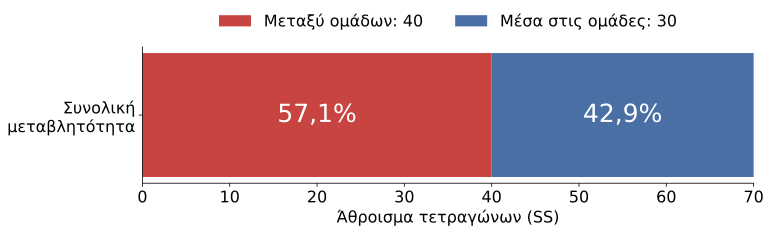
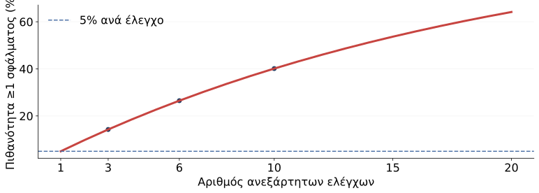
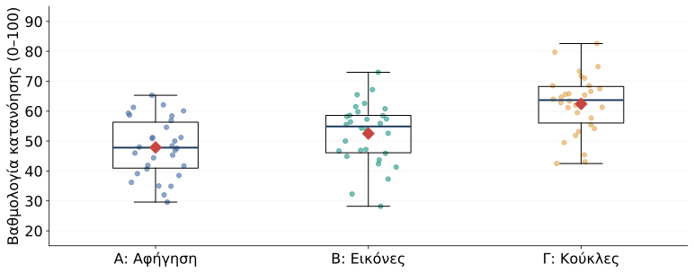
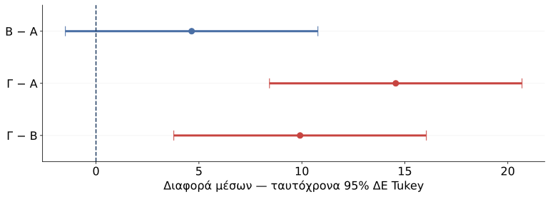

## Στόχοι

Την προηγούμενη φορά απαντήσαμε: υπάρχει τουλάχιστον μία διαφορά;

Σήμερα θα απαντήσουμε:

1. Πόσο μεγάλη είναι η επίδραση;
2. Ποιες ομάδες διαφέρουν;
3. Πώς εκτελούμε και παρουσιάζουμε μια πλήρη ανάλυση;

# Μέγεθος επίδρασης

## Ζητήματα με την τιμή $p$

::: {.columns}
::: {.column width="50%"}
::: {.mini-card}
**Στατιστική σημαντικότητα**

Πόσο ασύμβατα είναι τα δεδομένα με την υπόθεση ίσων μέσων;

Η τιμή $p$ επηρεάζεται και από το **μέγεθος του δείγματος**.
:::
:::
::: {.column width="50%"}
::: {.mini-card .between-card}
**Μέγεθος επίδρασης**

Πόσο έντονες είναι οι διαφορές σε σχέση με τη μεταβλητότητα;

Συμπληρώνει την τιμή $p$ με πληροφορία για το **μέγεθος της διαφοράς**.
:::
:::
:::

::: {.takeaway}
Στατιστικά σημαντική διαφορά δεν σημαίνει αυτομάτως σημαντική διαφορά για την εκπαιδευτική πράξη.
:::

## Γιατί αναφέρουμε μέγεθος επίδρασης;

- Για να μην περιορίζουμε το συμπέρασμα στο «σημαντικό / μη σημαντικό».
- Για να περιγράφουμε πόσο διαφέρουν οι ομάδες.
- Για να διευκολύνουμε συγκρίσεις με άλλες, παρόμοιες μελέτες.
- Για να συνδέουμε το αποτέλεσμα με την εκπαιδευτική του σημασία.

::: {.discussion}
Μια διαφορά **1 μονάδας σε κλίμακα 0–100** μπορεί να έχει $p<0{,}05$.  
Αρκεί αυτό για να αλλάξουμε μια εκπαιδευτική πρακτική;
:::

::: {.notes}
Όχι. Συζητήστε κόστος, διάρκεια, αξιοπιστία μέτρησης και διαστήματα εμπιστοσύνης. Τα τυποποιημένα μεγέθη επίδρασης διευκολύνουν συγκρίσεις, αλλά δεν εξαλείφουν τις διαφορές σχεδιασμού ή πληθυσμού.
:::

## To προηγούμενο παράδειγμα

Ανάκληση λέξεων μετά από αφήγηση, εικόνες ή κουκλοθέατρο.

| Ποσότητα                 |          Τιμή |
|:-------------------------|--------------:|
| Παιδιά / ομάδες          | $N=15$, $k=3$ |
| Μέσοι ομάδων             |       4, 6, 8 |
| Μεταξύ ομάδων            |     $SS_B=40$ |
| Μέσα στις ομάδες         |     $SS_W=30$ |
| Συνολικά                 |     $SS_T=70$ |
| Μέσο τετράγωνο σφάλματος |  $MS_W=2{,}5$ |

::: {.takeaway}
Γνωρίζουμε ήδη ότι $F(2,12)=8{,}00$, $p=0{,}006$. Πόσο μεγάλη είναι η επίδραση;
:::

## Ήτα τετράγωνο: $\eta^2$

::: {.hero-equation}
$$\eta^2=\frac{SS_B}{SS_T}=\frac{40}{70}=0{,}571$$
:::

- Δείχνει το ποσοστό της συνολικής μεταβλητότητας του **δείγματος** που συνδέεται με τις διαφορές μεταξύ ομάδων.
- Παίρνει τιμές από 0 έως 1, όταν $SS_T>0$.
- Εδώ: περίπου **57,1% της μεταβλητότητας** συνδέεται με την ομαδοποίηση.

## Γραφική ανπαράσταση του $\eta^2$

{.plot width="94%"}

::: {.takeaway}
Το **57,1% αφορά τη μεταβλητότητα**, όχι το ποσοστό των παιδιών που ωφελήθηκαν και όχι αύξηση της επίδοσης κατά 57,1%.
:::

## Πρόβλημα με $\eta^2$

Ακόμη και όταν οι πληθυσμιακοί μέσοι είναι ίσοι, οι δειγματικοί μέσοι συνήθως διαφέρουν λίγο.

- Το $\eta^2$ τείνει να **υπερεκτιμά** το πληθυσμιακό μέγεθος επίδρασης.
- Η υπερεκτίμηση μπορεί να είναι αισθητή σε μικρά δείγματα.
- Το **ωμέγα τετράγωνο**, $\omega^2$, διορθώνει μέρος αυτής της αστοχίας.

## Ωμέγα τετράγωνο: $\omega^2$

Για την κλασική μονοπαραγοντική ANOVA ανεξάρτητων ομάδων:

::: {.hero-equation}
$$\omega^2=\frac{SS_B-(k-1)MS_W}{SS_T+MS_W}$$
:::

$$\omega^2=\frac{40-2\cdot2{,}5}{70+2{,}5}=\frac{35}{72{,}5}=0{,}483$$

Το εκτιμώμενο ποσοστό είναι περίπου **48,3%**, αντί για 57,1%.

## Πώς ερμηνεύουμε το μέγεθος;

| Δείκτης    | Τι περιγράφει εδώ;                   |  Τιμή |
|:-----------|:-------------------------------------|------:|
| $\eta^2$   | Ποσοστό μεταβλητότητας στο δείγμα    | 0,571 |
| $\omega^2$ | Διορθωμένη εκτίμηση για τον πληθυσμό | 0,483 |

- Εξετάζουμε **και τους μέσους στις αρχικές μονάδες**: 4, 6 και 8 λέξεις.
- Συνεκτιμούμε το εκπαιδευτικό πλαίσιο και την αβεβαιότητα της εκτίμησης.

::: {.small-note}
Συχνά αναφέρονται ενδεικτικά όρια για το $\eta^2$: 0,01 / 0,06 / 0,14. Δεν είναι καθολικά κριτήρια εκπαιδευτικής σημασίας.
:::

## Παράδειγμα

::: {.discussion}
Μια μελέτη δίνει $p=0{,}002$ και $\eta^2=0{,}02$.

Μπορούμε να πούμε ότι η επίδραση είναι μεγάλη επειδή η τιμή $p$ είναι μικρή;
:::

::: {.fragment .answer-note}
**Όχι.** Το αποτέλεσμα είναι στατιστικά σημαντικό, αλλά η ομαδοποίηση συνδέεται με μόλις 2% της συνολικής μεταβλητότητας στο δείγμα. Χρειαζόμαστε και τις διαφορές μέσων για να αξιολογήσουμε την πρακτική σημασία.
:::

# Πολλαπλές συγκρίσεις

## Εντοπισμός διαφορών

Ο συνολικός έλεγχος $F$ εξετάζει:

$$H_0:\mu_A=\mu_B=\mu_\Gamma$$

Οι συγκρίσεις ανά ζεύγη εξετάζουν διαφορετικά ερωτήματα:

| Ζεύγος | Μηδενική υπόθεση     |
|:-------|:---------------------|
| Β – Α  | $\mu_B-\mu_A=0$      |
| Γ – Α  | $\mu_\Gamma-\mu_A=0$ |
| Γ – Β  | $\mu_\Gamma-\mu_B=0$ |
    
::: {.takeaway}
Ένα σημαντικό $F$ δεν σημαίνει ότι **όλα** τα ζεύγη διαφέρουν.
:::

## Πλήθος συγκρίσεων

Με $k$ ομάδες, όλα τα διαφορετικά ζεύγη είναι:

$$m=\frac{k(k-1)}{2}$$

| Ομάδες ($k$) | Συγκρίσεις ($m$) |
|-------------:|-----------------:|
|            3 |                3 |
|            4 |                6 |
|            5 |               10 |
|            6 |               15 |

::: {.discussion}
Αν κάθε έλεγχος έχει πιθανότητα σφάλματος τύπου Ι έως 5%, τι συμβαίνει όταν κάνουμε πολλούς ελέγχους;
:::

## Οικογενειακό σφάλμα: FWER

**Οικογένεια ελέγχων:** το σύνολο των συγκρίσεων για τις οποίες θέλουμε κοινό έλεγχο του σφάλματος.

::: {.hero-equation}
$$\mathrm{FWER}=P(\text{τουλάχιστον μία εσφαλμένη απόρριψη αληθούς }H_0)$$
:::

::: {.takeaway}
Στόχος: πιθανότητα **τουλάχιστον ενός** σφάλματος τύπου Ι στην οικογένεια έως $\alpha=0{,}05$.
:::

::: {.notes}
Ορίζουμε την οικογένεια πριν κοιτάξουμε ποιες συγκρίσεις βγαίνουν σημαντικές. Το FWER δεν είναι το αναμενόμενο ποσοστό λανθασμένων ευρημάτων ανάμεσα στα σημαντικά αποτελέσματα· αυτό σχετίζεται με το FDR και δεν είναι ο στόχος εδώ.
:::

## Το πρόβλημα με τους πολλούς ελέγχους

Αν **όλες οι $H_0$ είναι αληθείς** και οι έλεγχοι είναι **ανεξάρτητοι**, με σφάλμα 0,05 ο καθένας:

$$\mathrm{FWER}=1-(1-0{,}05)^m$$

| Έλεγχοι | Πιθανότητα τουλάχιστον ενός σφάλματος |
|--------:|--------------------------------------:|
|       1 |                                  5,0% |
|       3 |                                 14,3% |
|       6 |                                 26,5% |
|      10 |                                 40,1% |

::: {.small-note}
Οι συγκρίσεις ζευγών της ίδιας ANOVA μοιράζονται δεδομένα και **δεν είναι ανεξάρτητες**. Ο τύπος εδώ είναι ενδεικτική απεικόνιση, όχι ακριβής υπολογισμός του FWER.
:::

## Το σφάλμα συσσωρεύεται

{.plot width="93%"}

::: {.takeaway}
Το 5% ανά έλεγχο δεν εξασφαλίζει 5% για όλη την οικογένεια.
:::

## Διόρθωση Bonferroni

Μοιράζουμε το συνολικό $\alpha$ στους $m$ ελέγχους:

$$\alpha_{\text{ανά έλεγχο}}=\frac{0{,}05}{3}=0{,}0167$$

Ισοδύναμα, διορθώνουμε κάθε τιμή $p$:

$$p_{\text{Bonf}}=\min(mp,1)$$

::: {.mini-card}
Για αδιόρθωτο $p=0{,}020$: $p_{\text{Bonf}}=3\cdot0{,}020=0{,}060$.

**Δεν απορρίπτουμε** τη συγκεκριμένη $H_0$ στο οικογενειακό επίπεδο 0,05.
:::

::: {.small-note}
Ελέγχει το FWER χωρίς απαίτηση ανεξαρτησίας, εφόσον οι επιμέρους έλεγχοι είναι έγκυροι. Μπορεί να είναι συντηρητική.
:::

## Διόρθωση Holm: βήμα προς βήμα

Ταξινομούμε τις τιμές $p$ χωρίς διόρθωση από τη μικρότερη στη μεγαλύτερη.

| Βήμα | Υποθετικό $p$ |                Όριο | Απόφαση      |
|-----:|--------------:|--------------------:|:-------------|
|    1 |         0,004 | $0{,}05/3=0{,}0167$ | Απορρίπτουμε |
|    2 |         0,020 |  $0{,}05/2=0{,}025$ | Απορρίπτουμε |
|    3 |         0,040 |  $0{,}05/1=0{,}050$ | Απορρίπτουμε |

- Σταματάμε στην πρώτη μη απόρριψη και δεν απορρίπτουμε τις επόμενες.
- Ελέγχει το FWER και είναι τουλάχιστον εξίσου ισχυρή με την Bonferroni.

## Ποια μέθοδος για ποιο ερώτημα;

| Μέθοδος               | Χρήση                                                  |
|:----------------------|:-------------------------------------------------------|
| **Tukey HSD**         | Όλα τα ζεύγη μέσων, με κοινή διακύμανση                |
| **Holm / Bonferroni** | Διόρθωση μιας καθορισμένης οικογένειας έγκυρων ελέγχων |
| **Games–Howell**      | Ζεύγη μέσων χωρίς υπόθεση ίσων διακυμάνσεων            |

## Διόρθωση Tukey

Για κάθε ζεύγος λαμβάνουμε:

1. **Διαφορά μέσων**: μέσος πρώτης ομάδας μείον μέσος δεύτερης.
2. **Ταυτόχρονο 95% διάστημα εμπιστοσύνης** για τη διαφορά.
3. **Διορθωμένη τιμή $p$** για την οικογένεια όλων των ζευγών.

::: {.small-note}
Ταυτόχρονη κάλυψη 95%: σε επαναλαμβανόμενες μελέτες, η διαδικασία καλύπτει μαζί όλες τις πραγματικές διαφορές στο 95% των περιπτώσεων.
:::

## Παράδειγμα

**Υποθετικό παράδειγμα**, με κατεύθυνση **Β − Α**:

| Διαφορά μέσων | Ταυτόχρονο 95% ΔΕ | $p_{\text{Tukey}}$ |
|--------------:|:-----------------:|-------------------:|
|          +6,0 |   [1,2 · 10,8]    |              0,012 |

- Η Β έχει μέσο κατά **6 μονάδες μεγαλύτερο** από την Α στο δείγμα.
- Το διάστημα δεν περιλαμβάνει το 0.
- Υπάρχουν ενδείξεις διαφοράς και μετά τη διόρθωση.

::: {.discussion}
Αν αντιστρέψουμε τη σύγκριση σε Α − Β, τι αλλάζει;
:::

::: {.fragment .answer-note}
Η διαφορά γίνεται −6,0 και το ΔΕ [−10,8 · −1,2]. Η τιμή $p$ και η απόφαση δεν αλλάζουν.
:::

## Συχνές παρανοήσεις

- **«Το F είναι σημαντικό, άρα όλες οι ομάδες διαφέρουν».**  
  Χρειαζόμαστε τους ελέγχους ανά ζεύγη.
- **«Το p του Tukey χρειάζεται και Bonferroni».**  
  Είναι ήδη διορθωμένο για όλα τα ζεύγη.
- **«Το ζεύγος δεν είναι σημαντικό, άρα οι ομάδες είναι ίδιες».**  
  Η αποτυχία απόρριψης της $H_0$ δεν αποδεικνύει ισότητα ή ισοδυναμία.

::: {.takeaway}
Αναφέρουμε την κατεύθυνση, το μέγεθος, το διάστημα εμπιστοσύνης και τη διορθωμένη τιμή $p$.
:::

# Eφαρμογή

## Η νέα μελέτη

Μελετάμε αν ο τρόπος παρουσίασης μιας ιστορίας σχετίζεται με την **κατανόηση της ιστορίας** σε παιδιά προσχολικής ηλικίας.

- **90 διαφορετικά παιδιά**, 30 ανά ομάδα.
- Α: προφορική αφήγηση
- Β: αφήγηση με εικόνες 
- Γ: αφήγηση με κούκλες.

- Ίδια ιστορία και διάρκεια
- Kάθε παιδί συμμετέχει **μία φορά**.
- Ατομική αξιολόγηση με κοινή βαθμολογία κατανόησης **0–100**.

::: {.small-note}
Όλα τα δεδομένα είναι προσομοιωμένα. Η βαθμολογία είναι υποθετικός σύνθετος δείκτης, όχι πραγματικό σταθμισμένο τεστ. Υψηλότερη τιμή σημαίνει καλύτερη κατανόηση.
:::

## Τα δεδομένα

| Μεταβλητή             | Περιεχόμενο            | Ρόλος στο jamovi        |
|:----------------------|:-----------------------|:------------------------|
| `child_id`            | Μοναδικός κωδικός 1–90 | ID                      |
| `story_method`        | Α, Β ή Γ               | Ονομαστική / παράγοντας |
| `comprehension_score` | Βαθμολογία 0–100       | Συνεχής / εξαρτημένη    |

**Αρχείο:** `anova_study.csv`

## Το σχέδιο ανάλυσης

Πριν εξετάσουμε τις τιμές $p$:

1. Ελέγχουμε την εισαγωγή και την ποιότητα των δεδομένων.
2. Περιγράφουμε και απεικονίζουμε τις ομάδες.
3. Εκτελούμε ANOVA, με $\alpha=0{,}05$.
4. Υπολογίζουμε $\eta^2$ και $\omega^2$.
5. Συγκρίνουμε **και τα τρία ζεύγη με Tukey**.
6. Γράφουμε συμπέρασμα στο πλαίσιο της μελέτης.

## Βήμα 1: εισαγωγή δεδομένων στο jamovi

- Ανοίγουμε το `anova_study.csv` από **Open → This PC**.
- Ελέγχουμε τους τύπους των τριών μεταβλητών.
- Επιβεβαιώνουμε: **90 γραμμές**, μοναδικοί κωδικοί, τρεις ομάδες.
- Ελέγχουμε κενές τιμές, διπλοεγγραφές και τιμές εκτός 0–100.

::: {.answer-note}
**Στο αρχείο μας:** 90 μοναδικοί κωδικοί, 30 παιδιά ανά ομάδα, καμία ελλείπουσα τιμή, βαθμολογίες από 28,2 έως 82,6.
:::

::: {.small-note}
Τα αγγλικά ονόματα των επιλογών βοηθούν στον εντοπισμό τους. Η ακριβής εμφάνιση μπορεί να διαφέρει ανά έκδοση ή γλώσσα του jamovi.
:::

## Βήμα 2: περιγραφική στατιστική

**Analyses → Exploration → Descriptives**

`Variables`: βαθμολογία · `Split by`: τρόπος παρουσίασης.

| Ομάδα      | $n$ | Μέσος | Τυπική απόκλιση | Ελάχιστο | Μέγιστο |
|:-----------|----:|------:|----------------:|---------:|--------:|
| Α: Αφήγηση |  30 | 47,87 |            9,70 |     29,6 |    65,3 |
| Β: Εικόνες |  30 | 52,52 |           10,24 |     28,2 |    73,0 |
| Γ: Κούκλες |  30 | 62,43 |            9,94 |     42,5 |    82,6 |

::: {.discussion}
Η Γ έχει τον μεγαλύτερο δειγματικό μέσο. Αρκεί αυτό για να πούμε ότι διαφέρει από κάθε άλλη ομάδα στον πληθυσμό;
:::

## Πρώτα κοιτάμε τα παιδιά, όχι μόνο τους μέσους

{.plot width="94%"}

::: {.small-note}
Κουκίδες: παιδιά · κόκκινοι ρόμβοι: μέσοι · γραμμή μέσα στο κουτί: διάμεσος. Τα θηκογράμματα συνοψίζουν τη διασπορά, όχι την αβεβαιότητα της διαφοράς μέσων.
:::

## Βήμα 3: υποθέσεις και μοντέλο

$$H_0:\mu_A=\mu_B=\mu_\Gamma$$

$$H_1:\text{Δεν είναι όλοι οι πληθυσμιακοί μέσοι ίσοι.}$$

- Εξαρτημένη μεταβλητή: **βαθμολογία κατανόησης**.
- Παράγοντας: **τρόπος παρουσίασης**, με τρία επίπεδα.
- Επίπεδο σημαντικότητας: **0,05**.

::: {.takeaway}
Οι υποθέσεις αφορούν πληθυσμιακούς μέσους. Οι δειγματικοί μέσοι γνωρίζουμε ήδη ότι διαφέρουν αριθμητικά.
:::

## Ρυθμίσεις στο jamovi

**Analyses → ANOVA → ANOVA**

1. `Dependent Variable`: `comprehension_score`.
2. `Fixed Factors`: `story_method`.
3. `Effect Size`: επιλέγουμε **η² και ω²**.
4. `Post Hoc Tests`: μεταφέρουμε το `story_method`, επιλέγουμε **Tukey**.

::: {.small-note}
Χρησιμοποιούμε την πλήρη επιλογή «ANOVA». Η συντομευμένη «One-Way ANOVA» μπορεί να εμφανίζει διαφορετικές προεπιλογές ή λιγότερους δείκτες. Αν δεν εμφανίζονται ταυτόχρονα ΔΕ διαφορών, τα αναπαράγουμε με το συνοδευτικό R script.
:::

## Ο πίνακας ANOVA

| Πηγή             |        SS | df |       MS |         F |     p      |
|:-----------------|----------:|---:|---------:|----------:|:----------:|
| Μεταξύ ομάδων    |  3.318,59 |  2 | 1.659,30 | **16,72** | **<0,001** |
| Μέσα στις ομάδες |  8.633,25 | 87 |    99,23 |         — |     —      |
| Σύνολο           | 11.951,85 | 89 |        — |         — |     —      |

::: {.takeaway}
**Απορρίπτουμε την $H_0$.** Υπάρχουν ενδείξεις ότι τουλάχιστον δύο τρόποι παρουσίασης έχουν διαφορετική πληθυσμιακή μέση βαθμολογία κατανόησης.
:::

::: {.small-note}
$F(2,87)=16{,}72$, ακριβές $p\approx7{,}16\times10^{-7}$. Αναφέρουμε $p<0{,}001$, όχι $p=0{,}000$. Μικρές αποκλίσεις στα αθροίσματα οφείλονται στη στρογγυλοποίηση.
:::

## Βήμα 4: μέγεθος της επίδρασης

$$\eta^2=\frac{3318{,}59}{11951{,}85}=0{,}278$$

$$\omega^2=\frac{3318{,}59-2\cdot99{,}23}{11951{,}85+99{,}23}=0{,}259$$

::: {.takeaway}
Περίπου **27,8%** της μεταβλητότητας του δείγματος συνδέεται με τις διαφορές μεταξύ των τρόπων παρουσίασης. Η διορθωμένη εκτίμηση για τον πληθυσμό είναι περίπου **25,9%**.
:::

::: {.small-note}
Οι δείκτες αυτοί δεν σημαίνουν βελτίωση 27,8% ή 25,9% στη βαθμολογία. Είναι εκτιμήσεις με αβεβαιότητα, όχι γνωστές πληθυσμιακές σταθερές.
:::

## Βήμα 5: τα αποτελέσματα Tukey

Η διαφορά υπολογίζεται ως **πρώτη ομάδα − δεύτερη ομάδα**.

| Σύγκριση | Διαφορά μέσων | Ταυτόχρονο 95% ΔΕ | $p_{\text{Tukey}}$ |
|:---------|--------------:|:-----------------:|-------------------:|
| Β − Α    |         +4,65 |  [−1,49 · 10,78]  |              0,173 |
| Γ − Α    |        +14,56 |  [8,43 · 20,69]   |             <0,001 |
| Γ − Β    |         +9,91 |  [3,78 · 16,05]   |             <0,001 |

::: {.takeaway}
Η Γ διαφέρει από την Α και τη Β. Για τη Β έναντι της Α δεν έχουμε επαρκείς ενδείξεις διαφοράς στο οικογενειακό επίπεδο 0,05.
:::

::: {.small-note}
Το ακριβές διορθωμένο $p$ για Γ − Β είναι 0,000644. Όλα τα διαστήματα και οι τιμές $p$ αφορούν την ίδια οικογένεια τριών συγκρίσεων.
:::

## Τα διαστήματα δείχνουν και την αβεβαιότητα

{.plot width="94%"}

::: {.discussion}
Ποιο διάστημα περιλαμβάνει το 0; Τι μας λέει το εύρος του για τη σύγκριση Β − Α;
:::

::: {.notes}
Το Β − Α περιλαμβάνει από μικρή αρνητική έως θετική διαφορά περίπου 11 μονάδων. Δεν είναι απόδειξη ισοδυναμίας. Αποφύγετε τη φράση «δεν υπάρχει διαφορά». Τα ταυτόχρονα ΔΕ αφορούν διαφορές μέσων, όχι τις επιδόσεις μεμονωμένων παιδιών.
:::

## Η Β και η Α είναι ίδιες;

Για Β − Α: **+4,65 μονάδες**, 95% ΔΕ **[−1,49 · 10,78]**, $p=0{,}173$.

- Το δείγμα δείχνει μεγαλύτερο μέσο για τη Β.
- Το διάστημα παραμένει συμβατό και με μηδενική διαφορά.
- Δεν αποδεικνύουμε ότι η πραγματική διαφορά είναι ακριβώς μηδέν.

::: {.takeaway}
**Ορθή διατύπωση:** «Δεν διαπιστώθηκε στατιστικά σημαντική διαφορά μεταξύ της αφήγησης με εικόνες και της προφορικής αφήγησης μετά τη διόρθωση Tukey».
:::

## Βήμα 6: παρουσιάζουμε την ανάλυση

::: {.reporting}
Στα προσομοιωμένα δεδομένα 90 παιδιών, η μέση βαθμολογία κατανόησης ήταν 47,87 (ΤΑ = 9,70) για την αφήγηση, 52,52 (ΤΑ = 10,24) για τις εικόνες και 62,43 (ΤΑ = 9,94) για τις κούκλες. Η μονοπαραγοντική ANOVA έδειξε διαφορά μεταξύ των μέσων, **$F(2,87)=16{,}72$, $p<0{,}001$**, με **$\eta^2=0{,}278$** και **$\omega^2=0{,}259$**.
:::

::: {.notes}
Στην πλήρη αναφορά προσθέτουμε ότι ο σχεδιασμός προβλέπει ανεξαρτησία και τα διαγνωστικά δεν ανέδειξαν σοβαρό πρόβλημα κανονικότητας ή ομοιογένειας. Οι έλεγχοι παραδοχών δεν αποτελούν πιστοποιητικό ορθότητας.
:::

## Παρουσιάζουμε τις συγκεκριμένες διαφορές

::: {.reporting}
Οι συγκρίσεις Tukey έδειξαν υψηλότερη μέση επίδοση για τις κούκλες έναντι της αφήγησης (**ΔΜ = 14,56**, ταυτόχρονο 95% ΔΕ [8,43 · 20,69], $p<0{,}001$) και των εικόνων (**ΔΜ = 9,91**, [3,78 · 16,05], $p<0{,}001$). Η διαφορά εικόνων–αφήγησης δεν ήταν στατιστικά σημαντική (**ΔΜ = 4,65**, [−1,49 · 10,78], $p=0{,}173$).
:::

::: {.small-note}
Όλες οι τιμές $p$ αυτού του κειμένου είναι διορθωμένες με Tukey. ΔΜ = διαφορά μέσων, ΤΑ = τυπική απόκλιση.
:::

## Τι συμπεραίνουμε για την εκπαίδευση;

- Στο παράδειγμα, η Γ έχει υψηλότερη μέση επίδοση από τις άλλες ομάδες.
- Το πόσο αξίζει εκπαιδευτικά μια διαφορά 10 ή 15 μονάδων απαιτεί γνώση της κλίμακας και του πλαισίου.
- Η τυχαία κατανομή υποστηρίζει αιτιώδη ερμηνεία σε μια κατάλληλα εκτελεσμένη **πραγματική** μελέτη.
- Η γενίκευση εξαρτάται και από τον τρόπο επιλογής του δείγματος.

::: {.takeaway}
Τα δεδομένα μας είναι **προσομοιωμένα**. Μαθαίνουμε τη διαδικασία· δεν παράγουμε τεκμήριο υπεροχής μιας πραγματικής εκπαιδευτικής πρακτικής.
:::

