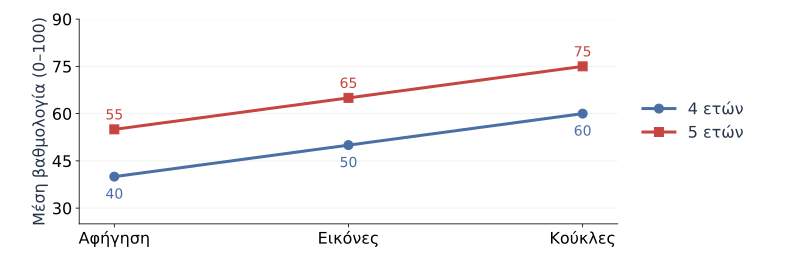
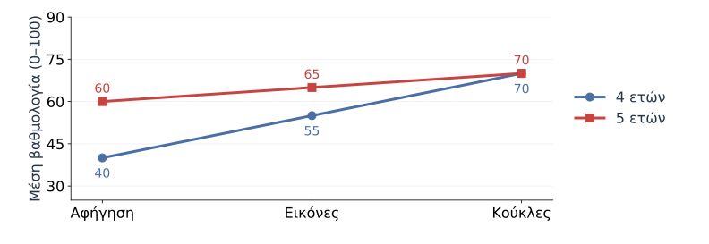
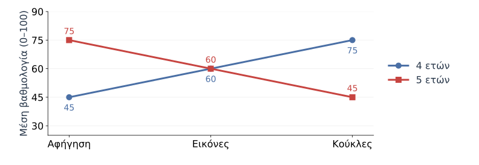

## Στόχοι

Την προηγούμενη φορά συγκρίναμε τρόπους παρουσίασης μιας ιστορίας.

\

Σήμερα προσθέτουμε ένα ερώτημα: **έχει σημασία και η ηλικία;**

# Το ερευνητικό ερώτημα

## Η μελέτη

Μελετάμε την **κατανόηση μιας ιστορίας** σε παιδιά προσχολικής ηλικίας.

::: {.columns}
::: {.column width="52%"}
**Παράγοντας Α: τρόπος παρουσίασης**

- Προφορική αφήγηση
- Αφήγηση με εικόνες
- Αφήγηση με κούκλες

**Παράγοντας Β: ηλικιακή ομάδα**

- 4 ετών
- 5 ετών
:::
::: {.column width="48%"}
::: {.mini-card}
**Έκβαση**

Βαθμολογία κατανόησης **0–100**.

Υψηλότερη βαθμολογία σημαίνει καλύτερη κατανόηση.
:::
:::
:::

## Τρία ερωτήματα

::: {.mini-card}
**Παρουσίαση:** διαφέρει η μέση κατανόηση μεταξύ των τρόπων παρουσίασης, κατά μέσο όρο στις δύο ηλικίες;
:::

::: {.mini-card}
**Ηλικία:** διαφέρει η μέση κατανόηση μεταξύ των ηλικιών, κατά μέσο όρο στους τρεις τρόπους;
:::

::: {.mini-card .between-card}
**Αλληλεπίδραση:** οι διαφορές μεταξύ των τρόπων παρουσίασης αλλάζουν ανάλογα με την ηλικία;
:::

## ANOVA δύο παραγόντων

- Έχουμε **μία αριθμητική εξαρτημένη μεταβλητή**.
- Έχουμε **δύο κατηγορικούς παράγοντες**.
- Θέλουμε να εξετάσουμε και τον **συνδυασμό** τους.

\

::: {.discussion}
Δύο χωριστές μονοπαραγοντικές ANOVA δεν ελέγχουν άμεσα αν οι διαφορές μεταξύ τρόπων παρουσίασης αλλάζουν με την ηλικία.
:::

## Ο σχεδιασμός

| Τρόπος παρουσίασης |    4 ετών |    5 ετών |
|:-------------------|----------:|----------:|
| Αφήγηση            | 30 παιδιά | 30 παιδιά |
| Εικόνες            | 30 παιδιά | 30 παιδιά |
| Κούκλες            | 30 παιδιά | 30 παιδιά |

- **3 × 2 = 6 συνδυασμοί**, δηλαδή έξι κελιά.
- **180 διαφορετικά παιδιά**, μία μέτρηση για κάθε παιδί.
- Ίσο πλήθος ανά κελί (ισορροπημένος σχεδιασμός).

::: {.takeaway}
Κάθε παιδί ανήκει σε έναν μόνο συνδυασμό παρουσίασης και ηλικίας.
:::

# Κύριες επιδράσεις και αλληλεπίδραση

## Μέσοι κελιών και οριακοί μέσοι

Παράδειγμα με ίσα πλήθη ανά κελί:

\

| Τρόπος | 4 ετών | 5 ετών | Μέσος τρόπου |
|:-------|-------:|-------:|-------------:|
| Αφήγηση | 40 | 60 | **50** |
| Εικόνες | 55 | 65 | **60** |
| Κούκλες | 70 | 70 | **70** |
| **Μέσος ηλικίας** | **55** | **65** | **60** |

\

- Οι έξι εσωτερικές τιμές είναι **μέσοι όροι των κελιών**.
- Η τελευταία στήλη και γραμμή δίνουν **οριακούς μέσους όρους**.

\

::: {.small-note}
Εδώ οι οριακοί μέσοι είναι απλοί μέσοι των αντίστοιχων κελιών. **Με άνισα πλήθη δεν ισχύει.**
:::

## Κύριες επιδράσεις

::: {.columns}
::: {.column width="50%"}
::: {.mini-card}
**Τρόπος παρουσίασης**

Οριακοί μέσοι: **50, 60, 70**.

Συνοψίζουν τη διαφορά μεταξύ τρόπων παρουσίασης, κατά μέσο όρο στις δύο ηλικίες.
:::
:::
::: {.column width="50%"}
::: {.mini-card}
**Ηλικιακή ομάδα**

Οριακοί μέσοι: **55 και 65**.

Συνοψίζουν τη διαφορά ηλικιών, κατά μέσο όρο στους τρεις τρόπους.
:::
:::
:::

\

::: {.takeaway}
Ο μέσος όρος μπορεί να κρύβει ότι η διαφορά είναι διαφορετική σε κάθε ηλικία.
:::

## Η έννοια της αλληλεπίδρασης

Στο ίδιο παράδειγμα, συγκρίνουμε **κούκλες − αφήγηση**:

| Ηλικία |    Διαφορά μέσων |
|:-------|-----------------:|
| 4 ετών | 70 − 40 = **30** |
| 5 ετών | 70 − 60 = **10** |

\

::: {.hero-equation}
Διαφορά των διαφορών: **30 − 10 = 20 μονάδες**
:::

\

::: {.takeaway}
**Αλληλεπίδραση:** η διαφορά που συνδέεται με τον έναν παράγοντα εξαρτάται από το επίπεδο του άλλου.
:::

## Χωρίς αλληλεπίδραση

{.plot width="92%"}

::: {.takeaway}
Οι γραμμές είναι παράλληλες: η διαφορά ηλικιών είναι πάντα 15 μονάδες. Οι διαφορές μεταξύ τρόπων παρουσίασης είναι ίδιες στις δύο ηλικίες.
:::

## Αλληλεπίδραση χωρίς διασταύρωση

{.plot width="92%"}

::: {.takeaway}
Η διαφορά κούκλες − αφήγηση είναι 30 μονάδες στα 4 έτη και 10 στα 5 έτη.
:::

## Αλληλεπίδραση με διασταύρωση

{.plot width="92%"}

::: {.discussion}
Ποιος τρόπος παρουσίασης έχει τον υψηλότερο μέσο σε κάθε ηλικία; Θα μας βοηθούσε εδώ μόνο ο συνολικός μέσος ανά τρόπο παρουσίασης;
:::

::: {.notes}
Στα 4 έτη οι κούκλες έχουν τον υψηλότερο μέσο, στα 5 η αφήγηση. Οι οριακοί μέσοι όλων των τρόπων είναι 60 και των δύο ηλικιών επίσης 60. Μπορεί να υπάρχει αλληλεπίδραση χωρίς κύριες επιδράσεις.
:::

## Δομή του γραφήματος

- Οριζόντιος άξονας: επίπεδα του τρόπου παρουσίασης.
- Κάθε γραμμή: μία ηλικιακή ομάδα.
- Κατακόρυφος άξονας: **μέση βαθμολογία**, όχι μεμονωμένο παιδί.
- Αν δεν έχουμε παράλληλες γραμμές $\rightarrow$ περιγραφική ένδειξη αλληλεπίδρασης.

\

::: {.takeaway}
* Στα δείγματα οι γραμμές σπάνια είναι ακριβώς παράλληλες.  
* Ο έλεγχος αλληλεπίδρασης εξετάζει αν η απόκλιση είναι μεγαλύτερη από όση θα περιμέναμε λόγω τυχαίας διακύμανσης.
:::

## Συχνή παρανόηση

> «Η διαφορά είναι σημαντική στα 4 έτη και μη σημαντική στα 5. Άρα υπάρχει αλληλεπίδραση».

**Το συμπέρασμα αυτό δεν αρκεί.**

- Οι δύο τιμές $p$ μπορεί να διαφέρουν λόγω αβεβαιότητας.
- Πρέπει να ελέγξουμε **τη διαφορά των διαφορών**.

# Η λογική του ελέγχου

## Ανάλυση της διασποράς

Στον ισορροπημένο σχεδιασμό μας:

\

::: {.hero-equation}
SSσύνολο = SSτρόπος + SSηλικία + SSαλληλεπίδραση + SSσφάλμα
:::

\

Για κάθε όρο:

**MS = SS / βαθμοί ελευθερίας**

**F = MS του όρου / MS σφάλματος**

\

::: {.takeaway}
Η ίδια ιδέα με την προηγούμενη ANOVA: συγκρίνουμε τη μεταβλητότητα που αποδίδεται στον όρο με τη μεταβλητότητα μέσα στα κελιά.
:::

::: {.notes}
Δεν ζητούνται υπολογισμοί με το χέρι. Η απλή προσθετική διάσπαση SS αφορά τον πλήρη ισορροπημένο σχεδιασμό. Σε μη ισορροπημένα δεδομένα οι τύποι SS και η ερμηνεία χρειάζονται πρόσθετη προσοχή.
:::

## Υποθέσεις για τις κύριες επιδράσεις

\

| Έλεγχος | Μηδενική υπόθεση H₀ | Εναλλακτική H₁ |
|:--------|:--------------------|:---------------|
| Τρόπος | Οι τρεις πληθυσμιακοί οριακοί μέσοι είναι ίσοι. | Τουλάχιστον δύο διαφέρουν. |
| Ηλικία | Οι δύο πληθυσμιακοί οριακοί μέσοι είναι ίσοι. | Οι δύο μέσοι διαφέρουν. |

\

::: {.takeaway}
Οι υποθέσεις αφορούν **τον πληθυσμό**. Εδώ οριακός μέσος σημαίνει μέσος με ίση στάθμιση των επιπέδων του άλλου παράγοντα.
:::

## Υποθέσεις για την αλληλεπίδραση

::: {.mini-card}
**H₀:** οι διαφορές μεταξύ τρόπων είναι ίδιες στις δύο ηλικιακές ομάδες.  
Δεν υπάρχει αλληλεπίδραση στον πληθυσμό.
:::

\

::: {.mini-card .between-card}
**H₁:** τουλάχιστον μία διαφορά μεταξύ τρόπων αλλάζει με την ηλικία.
:::

\

::: {.takeaway}
Για H₀ αρκεί να είναι μηδέν και οι δύο διαφορές διαφορών: 
(Εικόνες − Αφήγηση)4 − (Εικόνες − Αφήγηση)5 
(Κούκλες − Αφήγηση)4 − (Κούκλες − Αφήγηση)5
:::

## Ο πίνακας ANOVA

| Πηγή            | df στο παράδειγμα | Τι ελέγχουμε;           |
|:----------------|:-----------------:|:------------------------|
| Τρόπος          |   3 − 1 = **2**   | Κύρια επίδραση τρόπου   |
| Ηλικία          |   2 − 1 = **1**   | Κύρια επίδραση ηλικίας  |
| Τρόπος × Ηλικία |   2 × 1 = **2**   | Αλληλεπίδραση           |
| Υπόλοιπα        | 180 − 6 = **174** | Διασπορά μέσα στα κελιά |

\

- Κάθε ένας από τους τρεις όρους έχει **δικό του F και p**.
- Οι βαθμοί ελευθερίας του παρονομαστή είναι **174**.
- Ορίζουμε **α = 0,05** για κάθε ερευνητικό έλεγχο.

\

## Ο συνολικός έλεγχος

**H₀:** και οι έξι πληθυσμιακοί μέσοι κελιών είναι ίσοι.

**H₁:** τουλάχιστον δύο από τους έξι μέσους διαφέρουν.

\

- Συγκρίνουμε το πλήρες μοντέλο με ένα μοντέλο μόνο γενικού μέσου.
- Εδώ: **F με df = 5 και 174**.
- Στο jamovi: ενεργοποιούμε **Overall model test**.

\

::: {.takeaway}
Ο συνολικός έλεγχος δείχνει αν υπάρχει κάποια διαφορά. Οι τρεις επιμέρους έλεγχοι ξεχωρίζουν τρόπο, ηλικία και αλληλεπίδραση.
:::

## Πώς διαβάζουμε το αποτέλεσμα;

1. Ξεκινάμε από την **αλληλεπίδραση** και το γράφημά της.
2. Αν υπάρχουν ενδείξεις αλληλεπίδρασης, εξετάζουμε τις διαφορές **μέσα σε κάθε ηλικία**.
3. Διαβάζουμε τις κύριες επιδράσεις ως **μέσες διαφορές**.
4. Αν δεν υπάρχουν επαρκείς ενδείξεις αλληλεπίδρασης.

## Πόσο μεγάλη είναι η επίδραση;

Συνεχίζοντας την προηγούμενη διάλεξη, αναφέρουμε και **μερικό η²**.

::: {.hero-equation}
η²p = SSόρου / (SSόρου + SSσφάλματος)
:::

- Συγκρίνει τη μεταβλητότητα του συγκεκριμένου όρου με αυτήν του όρου και του σφάλματος μαζί.
- Δεν είναι ποσοστό βελτίωσης της βαθμολογίας.
- Τα μερικά η² των όρων **δεν χρειάζεται να αθροίζουν σε 1**.

::: {.takeaway}
Για την εκπαιδευτική ερμηνεία κοιτάμε επίσης τις διαφορές μέσων στην αρχική κλίμακα 0–100.
:::

# Post-hoc συγκρίσεις

## Ποιες ομάδες διαφέρουν;

::: {.columns}
::: {.column width="50%"}
::: {.mini-card}
**Κύρια επίδραση τρόπου παρουσίασης**

Τρία ζεύγη οριακών μέσων:

- Εικόνες − Αφήγηση
- Κούκλες − Αφήγηση
- Κούκλες − Εικόνες

Περιγράφουν διαφορές κατά μέσο όρο στις ηλικίες.
:::
:::
::: {.column width="50%"}
::: {.mini-card .between-card}
**Διερεύνηση αλληλεπίδρασης**

Τα ίδια τρία ζεύγη **στα 4 έτη** και **στα 5 έτη**.

:::
:::
:::

## Η διόρθωση για πολλαπλές συγκρίσεις

Για την άσκηση ορίζουμε **μία οικογένεια: όλα τα ζεύγη των έξι κελιών**.

- Έξι κελιά δίνουν **15 συγκρίσεις**.
- Επιλέγουμε **Tukey** για ολόκληρη την οικογένεια.
- Ερμηνεύουμε κυρίως τις **έξι συγκρίσεις τρόπων παρουσίασης μέσα στην ίδια ηλικία**.
- Η διόρθωση εξακολουθεί να αφορά και τις 15 συγκρίσεις.

\

::: {.notes}
Εναλλακτικά μπορεί να οριστεί εκ των προτέρων οικογένεια έξι απλών συγκρίσεων με Holm στο πλήρες μοντέλο. Δεν αναμένεται να δώσει τις ίδιες τιμές p με το Tukey των 15. Η συγκεκριμένη άσκηση χρησιμοποιεί post-hoc στον όρο αλληλεπίδρασης με Tukey για τα 15 ζεύγη.
:::

# Άσκηση στο jamovi

## Ερευνητικό σενάριο

Μια ομάδα μελετά αν η κατανόηση μιας ιστορίας διαφέρει ανάλογα με **τον τρόπο παρουσίασης και την ηλικία**.

- **180 παιδιά**, 90 ηλικίας 4 ετών και 90 ηλικίας 5 ετών.
- Μέσα σε κάθε ηλικία κατανέμονται τυχαία στους τρεις τρόπους.
- Ίδια ιστορία, διάρκεια και ατομική αξιολόγηση.
- Κάθε παιδί συμμετέχει **μία φορά**, σε ατομική συνεδρία.

::: {.takeaway}
Τα δεδομένα είναι **προσομοιωμένα**. Η ηλικία δεν κατανέμεται τυχαία και η διαφορά ηλικιών δεν αποτελεί από μόνη της αιτιώδη επίδραση.
:::

## Οι μεταβλητές

**Αρχείο:** `two_way_anova.csv`

| Στήλη                 | Περιεχόμενο                    | Ρόλος στο jamovi        |
|:----------------------|:-------------------------------|:------------------------|
| `child_id`            | Μοναδικός κωδικός 1–180        | ID                      |
| `story_method`        | Αφήγηση, Εικόνες, Κούκλες      | Nominal / παράγοντας    |
| `age_group`           | 4 ετών, 5 ετών                 | Nominal / παράγοντας    |
| `comprehension_score` | Βαθμολογία 0–100, ένα δεκαδικό | Continuous / εξαρτημένη |

::: {.takeaway}
Η βαθμολογία είναι αριθμητική. Η ηλικιακή ομάδα χρησιμοποιείται ως κατηγορία, όχι ως συνεχής μεταβλητή.
:::

## Ερώτημα 1: περιγράψτε τα δεδομένα

1. Ελέγξτε πλήθος γραμμών, μοναδικούς κωδικούς και ελλείπουσες τιμές.
2. Παρουσιάστε πίνακα συχνοτήτων **τρόπος παρουσίασης × ηλικία**.
3. Για καθένα από τα έξι κελιά, υπολογίστε **n, μέσο, διάμεσο, τυπική απόκλιση, ελάχιστο και μέγιστο**.
4. Κατασκευάστε θηκογράμματα και γράφημα μέσων ανά τρόπο και ηλικία.
5. Περιγράψτε τις διαφορές πριν δείτε τις τιμές p.

::: {.small-note}
Analyses → Exploration → Descriptives. Variables: comprehension_score. Split by: story_method και age_group. Τα διαγράμματα διασποράς των βαθμολογιών και τα ΔΕ μέσων απαντούν σε διαφορετικά ερωτήματα.
:::

## Ερώτημα 2: διατυπώστε τις υποθέσεις

Γράψτε με λόγια τις **H₀ και H₁** για:

1. Την κύρια επίδραση του τρόπου.
2. Την κύρια επίδραση της ηλικίας.
3. Την αλληλεπίδραση τρόπου και ηλικίας.
4. Τον συνολικό έλεγχο του μοντέλου.

::: {.discussion}
Ποιος από τους ελέγχους απαντά στο ερώτημα «ο τρόπος παρουσίασης έχει την ίδια σχέση με την κατανόηση στις δύο ηλικίες»;
:::

## Ερώτημα 3: εκτελέστε την ANOVA

**Analyses → ANOVA → ANOVA**

1. `Dependent Variable`: **comprehension_score**.
2. `Fixed Factors`: **story_method**, **age_group**.
3. Στο `Model`, επιβεβαιώστε τους όρους **story_method**, **age_group**, **story_method × age_group**.
4. Ενεργοποιήστε **Overall model test** και **Partial η²**.

## Το γράφημα αλληλεπίδρασης στο jamovi

Στο **Estimated Marginal Means**:

1. Προσθέστε **μαζί** τους δύο παράγοντες στον ίδιο όρο.
2. Ζητήστε **Marginal means tables** και **Marginal means plots**.
3. Επιλέξτε διαστήματα εμπιστοσύνης **95%**.
4. Εντοπίστε ποια γραμμή αντιστοιχεί σε κάθε ηλικία.

::: {.takeaway}
Στον πλήρη σχεδιασμό μας οι εκτιμώμενοι μέσοι των έξι κελιών ισούνται με τους παρατηρημένους μέσους τους.
:::

::: {.small-note}
Η επικάλυψη ή μη των ΔΕ των μέσων δεν αντικαθιστά τον έλεγχο αλληλεπίδρασης ή τον έλεγχο της διαφοράς μέσων.
:::

## Τι πρέπει να αναφέρετε;

- Τον **συνολικό F(5,174)** και την τιμή p.
- Για κάθε όρο: **F, df, p και μερικό η²**.
- Την απόφαση για κάθε H₀ στο επίπεδο **0,05**.
- Τι έδειξαν τα διαγνωστικά και τι υποθέτουμε για την ανεξαρτησία.
- Την ερμηνεία της αλληλεπίδρασης με αναφορά στο γράφημα.

::: {.takeaway}
Ένα σημαντικό συνολικό F δεν σημαίνει ότι όλοι οι όροι ή όλα τα ζεύγη είναι σημαντικά.
:::

## Ερώτημα 4: post-hoc έλεγχοι

Στο **Post Hoc Tests**:

1. Μεταφέρετε τον όρο **story_method × age_group**.
2. Επιλέξτε **Tukey** για όλα τα ζεύγη των έξι κελιών.
3. Εντοπίστε τις συγκρίσεις όπου η **ηλικία παραμένει ίδια**.
4. Παρουσιάστε τις τρεις διαφορές τρόπων στα 4 έτη και τις τρεις στα 5 έτη.
5. Αναφέρετε διαφορά μέσων, διορθωμένο p και συμπέρασμα.

::: {.small-note}
Αν εμφανίζονται ΔΕ διαφορών, ελέγξτε ποια διόρθωση χρησιμοποιούν. Το συνοδευτικό αρχείο διδάσκοντα παρέχει ταυτόχρονα ΔΕ Tukey. Τα ΔΕ των μέσων από το προηγούμενο βήμα δεν είναι ΔΕ διαφορών.
:::

## Παρουσιάζουμε το αποτέλεσμα

::: {.reporting}
«Η ANOVA δύο παραγόντων έδειξε … αλληλεπίδραση τρόπου και ηλικίας, F(…, …) = …, p = …, η²p = … . Στα παιδιά 4 ετών …, ενώ στα παιδιά 5 ετών … . Οι συγκρίσεις Tukey, διορθωμένες για τα 15 ζεύγη κελιών, έδειξαν …».
:::

::: {.takeaway}
Συμπληρώστε με τα αποτελέσματά σας. Συνδέστε τα ευρήματα με τις **μέσες βαθμολογίες**, όχι μόνο με τις τιμές p.
:::

