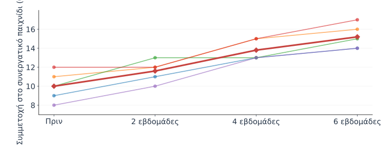

# Tο *t*-test εξαρτημένων δειγμάτων

## Το ερώτημα

Μια νηπιαγωγός βαθμολογεί τη συμμετοχή των ίδιων παιδιών στο συνεργατικό παιχνίδι:

::: {.columns}
::: {.column width="50%"}
::: {.mini-card}
**Πριν από ένα πρόγραμμα**

Κάθε παιδί έχει μία βαθμολογία συμμετοχής.
:::
:::
::: {.column width="50%"}
::: {.mini-card .between-card}
**Μετά από δύο εβδομάδες**

Τα ίδια παιδιά βαθμολογούνται ξανά με το ίδιο πρωτόκολλο.
:::
:::
:::

\

Με δύο χρονικές στιγμές χρησιμοποιούμε το **t-test εξαρτημένων δειγμάτων**.

::: {.takeaway}
Δεν συγκρίνουμε δύο ανεξάρτητες μέσες τιμές.  
Για κάθε παιδί εξετάζουμε τη **διαφορά των δύο δικών του βαθμολογιών**.
:::

## Τα δεδομένα

\

| Παιδί | Πριν | Μετά | Διαφορά Μετά − Πριν |
|:------|-----:|-----:|--------------------:|
| Ν1    |    9 |   11 |                  +2 |
| Ν2    |   11 |   12 |                  +1 |
| Ν3    |   10 |   13 |                  +3 |

\

- Οι δύο τιμές στην ίδια γραμμή ανήκουν στο **ίδιο παιδί**.
- Παιδιά που συνήθως συμμετέχουν περισσότερο τείνουν να έχουν υψηλότερη βαθμολογία και στις δύο στιγμές.
- Αυτή η σταθερή ατομική διαφορά είναι χρήσιμη πληροφορία· δεν πρέπει να αντιμετωπίζεται ως τυχαίο σφάλμα.

## Η υπόθεση του *t*-test εξαρτημένων δειγμάτων

::: {.hero-equation}
$$H_0: \mu_D = 0 \qquad \text{έναντι} \qquad H_1: \mu_D \ne 0$$
:::

όπου $D_i=Y_{i,\text{μετά}}-Y_{i,\text{πριν}}$ είναι η διαφορά για το παιδί $i$.

\

- Για δύο μετρήσεις, το ερώτημα είναι **μία μέση διαφορά**.
- Ο έλεγχος βασίζεται στη μεταβλητότητα των διαφορών $D_i$.

## Γενικεύοντας το ερώτημα

\

Τι γίνεται αν παρατηρούμε τα ίδια παιδιά σε **τέσσερις** στιγμές;

| Χρόνος  |       Πριν       | 2 εβδομάδες  |   4 εβδομάδες    |     6 εβδομάδες     |
|:--------|:----------------:|:------------:|:----------------:|:-------------------:|
| Ερώτημα | αρχική συμμετοχή | πρώτη αλλαγή | ενδιάμεση πορεία | διατήρηση / εξέλιξη |

::: {.discussion}
Υπάρχει συνολικά μεταβολή της μέσης συμμετοχής στον χρόνο ή οι τέσσερις πληθυσμιακοί μέσοι είναι ίσοι;
:::

## Γιατί όχι πολλά *t*-tests;

Με τέσσερις χρονικές στιγμές υπάρχουν οι ακόλουθες συγκρίσεις:

- Πριν − 2 εβδομάδες
- Πριν − 4 εβδομάδες
- Πριν − 6 εβδομάδες,
- 2 − 4 εβδομάδες
- 2 − 6 εβδομάδες
- 4 − 6 εβδομάδες.

\

Έξι *t*-tests στο $\alpha=0{,}05$ αυξάνουν την πιθανότητα τουλάχιστον ενός ψευδώς θετικού αποτελέσματος.

::: {.takeaway}
**ΛΥΣΗ**  
Πρώτα κάνουμε **έναν συνολικό έλεγχο** με ANOVA επαναλαμβανόμενων μετρήσεων. Αν χρειάζεται, ακολουθούν διορθωμένες συγκρίσεις.
:::

## Η ANOVA επαναλαμβανόμενων μετρήσεων

- Μία **αριθμητική εξαρτημένη μεταβλητή**.
- Ένας παράγοντας με πολλά επίπεδα (π.χ. χρόνος).
- Κάθε παιδί δίνει τιμή σε κάθε επίπεδο του παράγοντα.
- Εδώ: ο παράγοντας **Χρόνος** έχει τέσσερα επίπεδα.

::: {.mini-card}
**Μηδενική υπόθεση**

$$H_0:\mu_{\text{πριν}}=\mu_{2\ εβδομάδες}=\mu_{4\ εβδομάδες}=\mu_{6\ εβδομάδες}$$
:::

::: {.takeaway}
Η ANOVA απαντά αν υπάρχει ένδειξη για **κάποια** διαφορά στον χρόνο  
**ΠΡΟΣΟΧΗ**: δεν λέει ακόμη ποια ζεύγη διαφέρουν.
:::

## Διαφορές από ANOVA ενός παράγοντα

\

|                            | ANOVA ενός παράγοντα | ANOVA επαναλαμβανόμενων μετρήσεων |
|:---------------------------|:---------------------|:----------------------------------|
| Παιδιά ανά επίπεδο         | διαφορετικά          | τα ίδια                           |
| Παρατηρήσεις μέσα σε παιδί | μία                  | περισσότερες                      |
| Συσχέτιση των τιμών        | δεν αναμένεται       | αναμένεται                        |
| Ατομικές διαφορές          | μέσα στο σφάλμα      | διαχωρίζονται από το σφάλμα       |

# Παράδειγμα

## Τα δεδομένα των πέντε παιδιών

Πέντε παιδιά συμμετέχουν σε πρόγραμμα συνεργατικού παιχνιδιού.  
Η νηπιαγωγός χρησιμοποιεί δείκτη συμμετοχής **0–30** σε τέσσερις στιγμές.

\

| Παιδί            |     Πριν | 2 εβδομάδες | 4 εβδομάδες | 6 εβδομάδες | Μέσος παιδιού |
|:-----------------|---------:|------------:|------------:|------------:|--------------:|
| Ν1               |        9 |          11 |          13 |          14 |         11,75 |
| Ν2               |       11 |          12 |          15 |          16 |         13,50 |
| Ν3               |       10 |          13 |          13 |          15 |         12,75 |
| Ν4               |       12 |          12 |          15 |          17 |         14,00 |
| Ν5               |        8 |          10 |          13 |          14 |         11,25 |
| **Μέσος χρόνου** | **10,0** |    **11,6** |    **13,8** |    **15,2** |     **12,65** |

## Η πορεία κάθε παιδιού

{.plot width="94%"}

::: {.takeaway}
Οι γραμμές δεν ξεκινούν όλες από το ίδιο επίπεδο.  
Η κόκκινη γραμμή συνοψίζει τη μέση πορεία
:::

## Τρεις πηγές μεταβλητότητας

Για κάθε βαθμολογία μπορούμε να σκεφτούμε τρεις αποκλίσεις:

::: {.three-terms}
::: {.term}
Χρόνος
διαφέρουν οι μέσες τιμές των τεσσάρων στιγμών;
:::
::: {.term}
Παιδιά
διαφέρουν οι μέσες τιμές των παιδιών;
:::
::: {.term}
Σφάλμα
ό,τι απομένει για κάθε παιδί και χρόνο.
:::
:::

::: {.takeaway}
Οι ατομικές διαφορές δεν είναι το υπόλοιπο σφάλμα. Τις αφαιρούμε πριν αξιολογήσουμε τη μεταβολή στον χρόνο.
:::

# Ανάλυση των αθροισμάτων τετραγώνων

## Η βασική διάσπαση

Στον μονοπαραγοντικό, πλήρη σχεδιασμό επαναλαμβανόμενων μετρήσεων:

::: {.hero-equation}
$$SS_{\text{σύνολο}}=SS_{\text{χρόνος}}+SS_{\text{παιδιά}}+SS_{\text{σφάλμα}}$$
:::

| Όρος | Τι περιγράφει; |
|:--|:--|
| $SS_{\text{χρόνος}}$ | διαφορές ανάμεσα στους μέσους χρόνου |
| $SS_{\text{παιδιά}}$ | σταθερές διαφορές ανάμεσα στα παιδιά |
| $SS_{\text{σφάλμα}}$ | διαφορές που δεν εξηγούνται ούτε από χρόνο ούτε από παιδί |

## Συνολική μεταβλητότητα

Ο γενικός μέσος του παραδείγματος είναι $\bar Y_{\text{συνολικό}}=12{,}65$.

::: {.hero-equation}
$$SS_{\text{συνολικό}}=\sum_{i=1}^{5}\sum_{j=1}^{4}(Y_{ij}-\bar Y_{\text{συνολικό}})^2=106{,}55$$
:::

Αυτή είναι η μεταβλητότητα όλων των 20 βαθμολογιών γύρω από έναν κοινό μέσο.

## Μεταβλητότητα που συνδέεται με τον χρόνο

Οι μέσοι χρόνοι είναι $10{,}0$, $11{,}6$, $13{,}8$ και $15{,}2$.

::: {.hero-equation}
$$SS_{\text{χρόνος}}=n\sum_{j=1}^{4}(\bar Y_{\text{χρόνος ( j )}}-\bar Y_{\text{συνολικό}})^2$$

$$=5\left[(10-12{,}65)^2+\dots+(15{,}2-12{,}65)^2\right]=79{,}75$$
:::

::: {.small-note}
Πολλαπλασιάζουμε με $n=5$, επειδή κάθε μέσος χρόνου αντιπροσωπεύει πέντε παιδιά.
:::

## Μεταβλητότητα ανάμεσα στα παιδιά

Οι μέσοι των παιδιών είναι $11{,}75$, $13{,}50$, $12{,}75$, $14{,}00$, $11{,}25$.

::: {.hero-equation}
$$SS_{\text{παιδιά}}=k\sum_{i=1}^{5}(\bar Y_{\text{παιδιού ( i )}}-\bar Y_{\text{συνολικό}})^2$$

$$=4\left[(11{,}75-12{,}65)^2+\dots+(11{,}25-12{,}65)^2\right]=21{,}30$$
:::

## Το σφάλμα

::: {.hero-equation}
$$SS_{\text{σφάλμα}}=SS_{\text{σύνολο}}-SS_{\text{χρόνος}}-SS_{\text{παιδιά}}$$

$$=106{,}55-79{,}75-21{,}30=5{,}50$$
:::

Το υπόλοιπο περιγράφει πόσο η παρατήρηση ενός παιδιού σε έναν χρόνο αποκλίνει από ό,τι θα περιμέναμε γνωρίζοντας:

- τον μέσο του παιδιού και
- τον μέσο του χρόνου.

## Όφελος από επαναλαμβανόμενες μετρήσεις 

Αν αντιμετωπίζαμε λανθασμένα τις τέσσερις στιγμές ως ανεξάρτητες ομάδες:

::: {.hero-equation}
$$SS_{\text{υπόλοιπο, ανεξάρτητο}}=SS_{\text{παιδιά}}+SS_{\text{σφάλμα}}=21{,}30+5{,}50=26{,}80$$
:::

Στην ANOVA επαναλαμβανόμενωνμ μετρήσεων το σφάλμα είναι **5,50**, όχι 26,80.

## Βαθμοί ελευθερίας

Για $n=5$ παιδιά και $k=4$ στιγμές:

| Πηγή   |        Βαθμοί ελευθερίας |
|:-------|-------------------------:|
| Χρόνος |              $k-1=4-1=3$ |
| Παιδιά |              $n-1=5-1=4$ |
| Σφάλμα | $(n-1)(k-1)=4\times3=12$ |
| Σύνολο |           $nk-1=20-1=19$ |
|        |                          |

## Μέσα τετράγωνα και $F$

::: {.hero-equation}
$$MS_{\text{χρόνος}}=\frac{79{,}75}{3}=26{,}58 \qquad
MS_{\text{σφάλμα}}=\frac{5{,}50}{12}=0{,}46$$

$$F=\frac{MS_{\text{χρόνος}}}{MS_{\text{σφάλμα}}}=\frac{26{,}58}{0{,}46}=58{,}00$$
:::

## Ο πίνακας ANOVA του μικρού παραδείγματος

| Πηγή   |     SS | df |    MS |         F |
|:-------|-------:|---:|------:|----------:|
| Χρόνος |  79,75 |  3 | 26,58 | **58,00** |
| Παιδιά |  21,30 |  4 |  5,33 |         — |
| Σφάλμα |   5,50 | 12 |  0,46 |         — |
| Σύνολο | 106,55 | 19 |     — |         — |

# Post-hoc συγκρίσεις

## Μετά τον συνολικό έλεγχο F

Αν ο έλεγχος χρόνου είναι σημαντικός, θέλουμε να μάθουμε **πού** βρίσκεται η διαφορά.

Για τέσσερις στιγμές έχουμε έξι ζεύγη:

| 1                  | 2                  | 3                  |
|:-------------------|:-------------------|:-------------------|
| Πριν − 2 εβδομάδες | Πριν − 4 εβδομάδες | Πριν − 6 εβδομάδες |
| 2 − 4 εβδομάδες    | 2 − 6 εβδομάδες    | 4 − 6 εβδομάδες    |

::: {.takeaway}
Κάθε σύγκριση είναι **ζευγαρωμένη**: η διαφορά υπολογίζεται μέσα στο ίδιο παιδί.
:::

## Πολλαπλότητα

Έξι απλές συγκρίσεις στο $\alpha=0{,}05$ έχουν συνολικά πιθανότητα σφάλματος τύπου Ι πάνω από 5%

| Προσέγγιση              | Πότε είναι χρήσιμη;                                 |
|:------------------------|:----------------------------------------------------|
| Bonferroni              | απλή, αλλά πιο συντηρητική                          |
| Holm                    | λιγότερο συντηρητική από Bonferroni                 |
| Tukey                   | διαθέσιμη ως επιλογή post-hoc στο jamovi            |

## Έλεγχοι Post-hoc και  προκαθορισμένη σύγκριση

::: {.columns}
::: {.column width="50%"}
::: {.mini-card}
**Προκαθορισμένη**

«Θα συγκρίνουμε Πριν με 6 εβδομάδες», επειδή αυτό ορίστηκε από το ερευνητικό ερώτημα πριν τη συλλογή.
:::
:::
::: {.column width="50%"}
::: {.mini-card .between-card}
**Post-hoc**

«Ας δούμε όλα τα ζεύγη, τώρα που βρήκαμε συνολικό αποτέλεσμα». Χρειάζεται διόρθωση πολλαπλότητας.
:::
:::
:::

::: {.takeaway}
Η διαφάνεια της διαδικασίας είναι σημαντικότερη από το να βρούμε το μικρότερο δυνατό $p$-value.
::γ:

## Τι αναφέρουμε για κάθε σύγκριση;

1. Ποιες δύο στιγμές συγκρίνονται.
2. Τη διαφορά μέσων στην αρχική κλίμακα.
3. Διάστημα εμπιστοσύνης της διαφοράς, όπου διατίθεται.
4. Τη διορθωμένη τιμή $p$ και τη μέθοδο διόρθωσης.
5. Την εκπαιδευτική ερμηνεία, όχι μόνο την ετικέτα «σημαντικό».

::: {.reporting}
«Η μέση συμμετοχή ήταν υψηλότερη στις 4 εβδομάδες από ό,τι πριν, με μέση ζευγαρωμένη διαφορά … μονάδων, $p_{\mathrm{Holm}}=…$.»
:::

# Άσκηση στο jamovi

