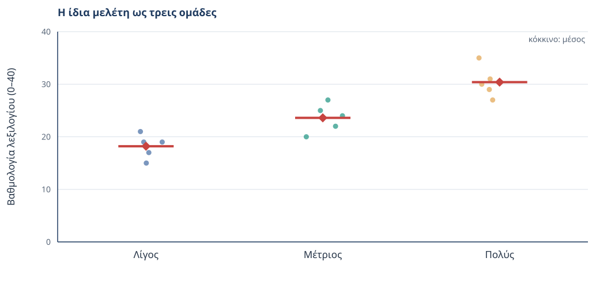
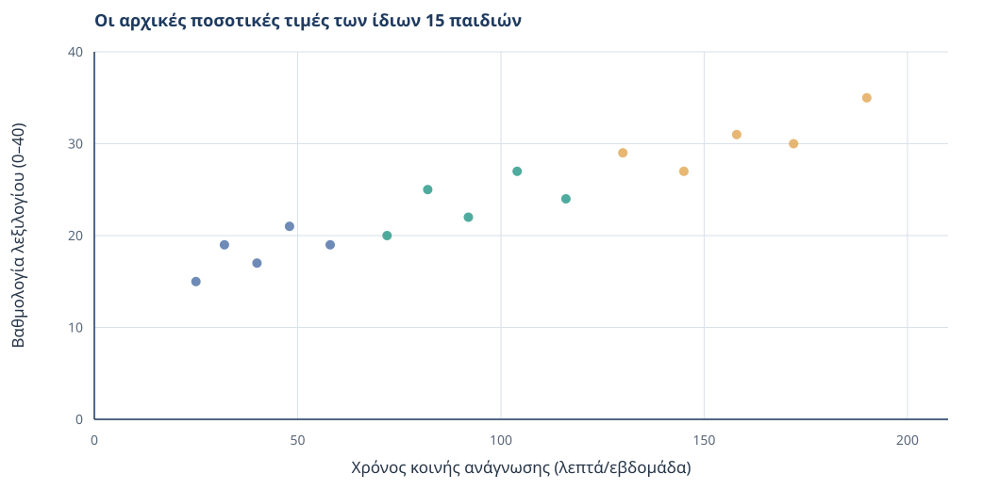
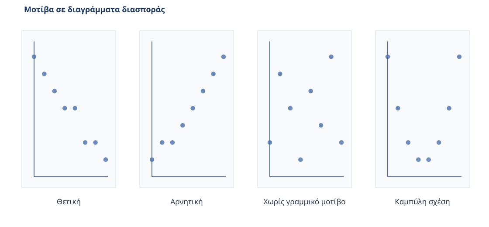
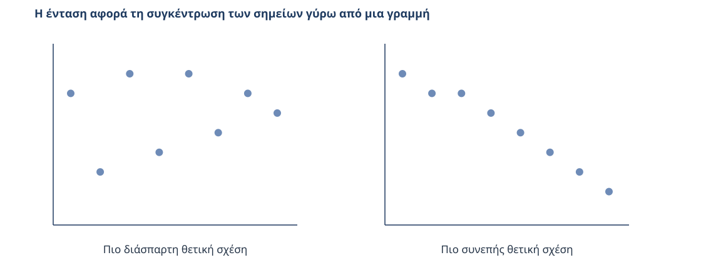
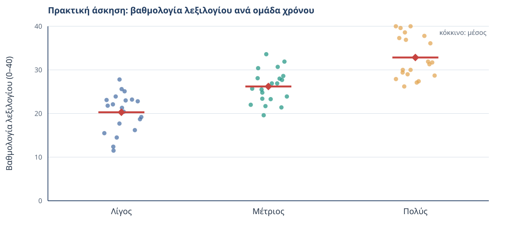
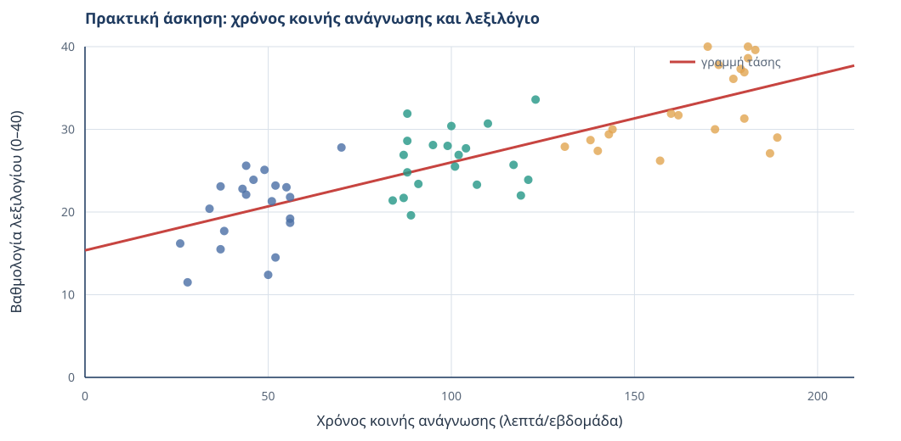

## Στόχοι

Στο τέλος του μαθήματος θα μπορείτε να:

1. διακρίνετε πότε ένα ερευνητικό ερώτημα χρειάζεται ANOVA και πότε συσχέτιση,
2. διαβάζετε τη διεύθυνση και την ένταση ενός διαγράμματος διασποράς,
3. υπολογίζετε και ερμηνεύετε τον συντελεστή Pearson $r$,
4. ελέγχετε τη μηδενική υπόθεση $H_0:\rho=0$ και
5. εκτελείτε ANOVA και Pearson συσχέτιση στο jamovi.

::: {.takeaway}
Σήμερα εξετάζουμε **μόνο τον συντελεστή γραμμικής συσχέτισης Pearson**.
:::

## Τι γνωρίζουμε ήδη;

Στις προηγούμενες διαλέξεις θέσαμε ερωτήματα για **διαφορές μέσων**:

::: {.columns}
::: {.column width="50%"}
::: {.mini-card}
**ANOVA ενός και δύο παραγόντων**

Συγκρίνουμε μέσες βαθμολογίες διαφορετικών ομάδων παιδιών.
:::
:::
::: {.column width="50%"}
::: {.mini-card .between-card}
**ANOVA επαναλαμβανόμενων μετρήσεων**

Συγκρίνουμε μέσες βαθμολογίες των ίδιων παιδιών σε διαφορετικές στιγμές.
:::
:::
:::

::: {.discussion}
Τι κάνουμε όταν δεν υπάρχουν ομάδες, αλλά έχουμε **δύο αριθμητικές μετρήσεις** για κάθε παιδί;
:::

# Από διαφορές σε σχέσεις

## Από τα μέσα των ομάδων στη σχέση μεταβλητών

| Μέθοδος | Ερευνητικό ερώτημα | Μεταβλητές |
|:--|:--|:--|
| *t*-test ανεξάρτητων δειγμάτων | Διαφέρουν δύο μέσοι; | μία κατηγορική με δύο ομάδες και μία ποσοτική |
| ANOVA ενός παράγοντα | Διαφέρουν οι μέσοι δύο ή περισσότερων ομάδων; | μία κατηγορική και μία ποσοτική |
| Pearson συσχέτιση | Συνδέονται γραμμικά δύο μεταβλητές; | δύο ποσοτικές |

::: {.takeaway}
Η επιλογή μεθόδου ξεκινά από το **ερευνητικό ερώτημα** και από τον **τύπο των μεταβλητών**.
:::

## Η μελέτη μας

Μια ερευνητική ομάδα καταγράφει, για κάθε παιδί προσχολικής ηλικίας:

::: {.columns}
::: {.column width="52%"}
::: {.mini-card}
**Χρόνος κοινής ανάγνωσης στο σπίτι**

Λεπτά ανά εβδομάδα όπου ένας ενήλικας και το παιδί διαβάζουν μαζί βιβλία.
:::
:::
::: {.column width="48%"}
::: {.mini-card .between-card}
**Δεκτικό λεξιλόγιο**

Βαθμολογία σε εκπαιδευτικό δείκτη λεξιλογίου, από 0 έως 40.
:::
:::
:::

**Ερευνητικό ερώτημα:** παιδιά με περισσότερο χρόνο κοινής ανάγνωσης τείνουν να έχουν διαφορετικές βαθμολογίες λεξιλογίου;

Υποθετικά δεδομένα για διδασκαλία. Η μελέτη είναι παρατηρητική.

## Προσέγγιση Α: ANOVA με ομάδες

Θα μπορούσαμε να μετατρέψουμε τον χρόνο ανάγνωσης σε τρεις κατηγορίες:

| Ομάδα χρόνου | Λεπτά ανά εβδομάδα |
|:--|:--|
| Λίγος χρόνος | έως 60 |
| Μέτριος χρόνος | 61 έως 120 |
| Πολύς χρόνος | 121 ή περισσότερα |

**Ερώτημα ANOVA:** διαφέρει η μέση βαθμολογία λεξιλογίου στις τρεις ομάδες χρόνου;

- Παράγοντας: ομάδα χρόνου κοινής ανάγνωσης.
- Εξαρτημένη μεταβλητή: βαθμολογία λεξιλογίου.

## Δεκαπέντε παιδιά, οργανωμένα σε ομάδες

| Παιδί | Λεπτά ανάγνωσης | Ομάδα χρόνου | Λεξιλόγιο |
|:--|--:|:--|--:|
| Ν01 | 25 | Λίγος | 15 |
| Ν02 | 32 | Λίγος | 19 |
| Ν03 | 40 | Λίγος | 17 |
| Ν04 | 48 | Λίγος | 21 |
| Ν05 | 58 | Λίγος | 19 |
| Ν06 | 72 | Μέτριος | 20 |
| Ν07 | 82 | Μέτριος | 25 |
| Ν08 | 92 | Μέτριος | 22 |
| Ν09 | 104 | Μέτριος | 27 |
| Ν10 | 116 | Μέτριος | 24 |
| Ν11 | 130 | Πολύς | 29 |
| Ν12 | 145 | Πολύς | 27 |
| Ν13 | 158 | Πολύς | 31 |
| Ν14 | 172 | Πολύς | 30 |
| Ν15 | 190 | Πολύς | 35 |

## Τι «βλέπει» η ANOVA;

{.plot width="94%"}

| Ομάδα χρόνου | $n$ | Μέσο λεξιλόγιο |
|:--|--:|--:|
| Λίγος | 5 | 18,2 |
| Μέτριος | 5 | 23,6 |
| Πολύς | 5 | 30,4 |

::: {.takeaway}
Η ANOVA συγκρίνει τους **τρεις μέσους**. Δεν χρησιμοποιεί τις ακριβείς αποστάσεις, π.χ. 72 έναντι 116 λεπτών.
:::

## Προσέγγιση Β: συσχέτιση

Αν διατηρήσουμε τον ακριβή χρόνο ανάγνωσης κάθε παιδιού:

::: {.mini-card}
**Ερώτημα συσχέτισης**

Υπάρχει γραμμική σχέση ανάμεσα στα λεπτά κοινής ανάγνωσης και στη βαθμολογία λεξιλογίου;
:::

- $X$: λεπτά κοινής ανάγνωσης ανά εβδομάδα.
- $Y$: βαθμολογία λεξιλογίου.
- Κάθε παιδί δίνει **ένα ζεύγος τιμών** $(X,Y)$.

## Τα ίδια παιδιά ως διάγραμμα διασποράς

{.plot width="94%"}

::: {.discussion}
Καθώς αυξάνονται τα λεπτά κοινής ανάγνωσης, τι φαίνεται να συμβαίνει συνήθως με τη βαθμολογία λεξιλογίου;
:::

::: {.notes}
Τα σημεία ανεβαίνουν γενικά προς τα δεξιά, αλλά δεν βρίσκονται πάνω σε μία τέλεια γραμμή. Ζητήστε περιγραφή πριν αναφερθεί ο αριθμητικός δείκτης.
:::

## Τι χάνεται με την κατηγοριοποίηση;

::: {.columns}
::: {.column width="50%"}
::: {.mini-card}
**ANOVA**

Τα παιδιά με 72 και 116 λεπτά μπαίνουν στην ίδια ομάδα «Μέτριος χρόνος».
:::
:::
::: {.column width="50%"}
::: {.mini-card .between-card}
**Συσχέτιση**

Κρατά κάθε αρχική τιμή και εξετάζει τη γραμμική συν-μεταβολή των δύο μετρήσεων.
:::
:::
:::

::: {.takeaway}
Η κατηγοριοποίηση μιας ποσοτικής μεταβλητής μπορεί να οδηγήσει σε απώλεια πληροφορίας.
:::

# Τι περιγράφει η συσχέτιση;

## Πρώτα κοιτάμε το διάγραμμα διασποράς

| Ερώτηση | Τι παρατηρούμε; |
|:--|:--|
| Κατεύθυνση | Τα σημεία τείνουν να ανεβαίνουν ή να κατεβαίνουν; |
| Ένταση | Τα σημεία ακολουθούν σχετικά κοντά μια νοητή γραμμή ή είναι διάσπαρτα; |
| Μορφή | Είναι το μοτίβο περίπου γραμμικό; |
| Ακραία σημεία | Υπάρχει σημείο που μπορεί να αλλάζει έντονα το συμπέρασμα; |

::: {.takeaway}
Ο Pearson $r$ δεν αντικαθιστά την προσεκτική ανάγνωση του γραφήματος.
:::

## Κατεύθυνση και μορφή

{.plot width="97%"}

::: {.small-note}
Ο Pearson $r$ περιγράφει τη **γραμμική** σχέση. Στην καμπύλη σχέση μπορεί να είναι κοντά στο 0, παρότι υπάρχει σαφές μοτίβο.
:::

## Θετική και αρνητική συσχέτιση

::: {.columns}
::: {.column width="50%"}
::: {.mini-card}
**Θετική**

Μεγαλύτερες τιμές του $X$ τείνουν να συνοδεύονται από μεγαλύτερες τιμές του $Y$.

Παράδειγμα: λεπτά κοινής ανάγνωσης και λεξιλόγιο.
:::
:::
::: {.column width="50%"}
::: {.mini-card .between-card}
**Αρνητική**

Μεγαλύτερες τιμές του $X$ τείνουν να συνοδεύονται από μικρότερες τιμές του $Y$.

Παράδειγμα: λεπτά καθιστικής οθόνης και διάρκεια ύπνου.
:::
:::
:::

## Η ένταση δεν είναι το πρόσημο

{.plot width="96%"}

::: {.takeaway}
Το πρόσημο (+ ή −) δείχνει την **κατεύθυνση**. Η απόσταση του $r$ από το 0 δείχνει την **ένταση της γραμμικής σχέσης**.
:::

## Ο συντελεστής Pearson $r$

::: {.hero-equation}
$$-1 \le r \le +1$$
:::

| Τιμή | Ερμηνεία |
|--:|:--|
| $+1$ | τέλεια θετική γραμμική σχέση |
| τιμές κοντά στο $+1$ | ισχυρότερη θετική γραμμική σχέση |
| $0$ | καμία γραμμική σχέση |
| τιμές κοντά στο $-1$ | ισχυρότερη αρνητική γραμμική σχέση |
| $-1$ | τέλεια αρνητική γραμμική σχέση |

Οι χαρακτηρισμοί «ασθενής», «μέτρια» και «ισχυρή» εξαρτώνται από το ερευνητικό πεδίο και δεν είναι καθολικά όρια.

## Συσχέτιση δεν σημαίνει αιτιότητα

Η θετική συσχέτιση της κοινής ανάγνωσης με το λεξιλόγιο **δεν αποδεικνύει** ότι η πρώτη προκαλεί το δεύτερο.

::: {.columns}
::: {.column width="50%"}
::: {.mini-card}
**Άλλες μεταβλητές**

Το γλωσσικό περιβάλλον, η πρόσβαση σε βιβλία ή το μορφωτικό επίπεδο των γονέων μπορεί να συνδέονται και με τις δύο μετρήσεις.
:::
:::
::: {.column width="50%"}
::: {.mini-card .between-card}
**Σχεδιασμός μελέτης**

Η μελέτη είναι παρατηρητική. Για αιτιακό ισχυρισμό χρειάζεται κατάλληλος ερευνητικός σχεδιασμός.
:::
:::
:::

# Υπολογισμός του Pearson $r$

## Η βασική ιδέα

Για κάθε παιδί εξετάζουμε δύο αποκλίσεις:

::: {.three-terms}
::: {.term}
$x_i-\bar{x}$

Πόσο απέχει ο χρόνος ανάγνωσης από τον μέσο χρόνο;
:::
::: {.term}
$y_i-\bar{y}$

Πόσο απέχει το λεξιλόγιο από τον μέσο όρο;
:::
::: {.term}
Γινόμενο

Έχουν συνήθως οι δύο αποκλίσεις ίδιο ή αντίθετο πρόσημο;
:::
:::

::: {.takeaway}
Δύο θετικές ή δύο αρνητικές αποκλίσεις δίνουν θετικό γινόμενο. Διαφορετικά πρόσημα δίνουν αρνητικό γινόμενο.
:::

## Ένα μικρό παράδειγμα

Χρησιμοποιούμε τα πρώτα πέντε παιδιά του παραδείγματος.

| Παιδί | $x_i$: λεπτά | $y_i$: λεξιλόγιο | $x_i-\bar{x}$ | $y_i-\bar{y}$ | Γινόμενο |
|:--|--:|--:|--:|--:|--:|
| Ν01 | 25 | 15 | −15,6 | −3,2 | 49,92 |
| Ν02 | 32 | 19 | −8,6 | 0,8 | −6,88 |
| Ν03 | 40 | 17 | −0,6 | −1,2 | 0,72 |
| Ν04 | 48 | 21 | 7,4 | 2,8 | 20,72 |
| Ν05 | 58 | 19 | 17,4 | 0,8 | 13,92 |

$$\bar{x}=40{,}6 \qquad \bar{y}=18{,}2$$

## Ο τύπος

::: {.hero-equation}
$$r=\frac{\sum_{i=1}^{n}(x_i-\bar{x})(y_i-\bar{y})}
{\sqrt{\sum_{i=1}^{n}(x_i-\bar{x})^2}\sqrt{\sum_{i=1}^{n}(y_i-\bar{y})^2}}$$
:::

- Ο αριθμητής συνοψίζει αν οι δύο μεταβλητές αποκλίνουν μαζί.
- Ο παρονομαστής προσαρμόζει το αποτέλεσμα στη μεταβλητότητα κάθε μεταβλητής.
- Γι' αυτό ο Pearson $r$ δεν έχει μονάδες μέτρησης και παίρνει τιμές μόνο από −1 έως +1.

## Υπολογισμός στο μικρό παράδειγμα

::: {.hero-equation}
$$\sum(x_i-\bar{x})(y_i-\bar{y})=78{,}40$$

$$\sum(x_i-\bar{x})^2=675{,}20 \qquad
\sum(y_i-\bar{y})^2=20{,}80$$

$$r=\frac{78{,}40}{\sqrt{675{,}20\cdot20{,}80}}=0{,}662$$
:::

::: {.takeaway}
Στα πέντε αυτά παιδιά βλέπουμε θετική, αλλά όχι τέλεια, γραμμική σχέση.
:::

## Τι δεν αλλάζει το $r$;

::: {.columns}
::: {.column width="50%"}
::: {.mini-card}
**Αντιστροφή των μεταβλητών**

Η συσχέτιση ανάμεσα σε $X$ και $Y$ είναι ίδια με τη συσχέτιση ανάμεσα σε $Y$ και $X$.
:::
:::
::: {.column width="50%"}
::: {.mini-card .between-card}
**Μονάδες μέτρησης**

Αν ο χρόνος γραφτεί σε ώρες αντί για λεπτά, το $r$ δεν αλλάζει.
:::
:::
:::

::: {.small-note}
Στη συσχέτιση δεν ορίζουμε μία μεταβλητή ως «εξαρτημένη» με τον τρόπο που το κάναμε στην ANOVA.
:::

# Έλεγχος συσχέτισης

## Από το δείγμα στον πληθυσμό

- Το $r$ είναι η συσχέτιση που παρατηρούμε στο **δείγμα**.
- Το $\rho$ είναι η άγνωστη γραμμική συσχέτιση στον **πληθυσμό**.
- Διαφορετικά τυχαία δείγματα από τον ίδιο πληθυσμό θα δώσουν συνήθως διαφορετικά $r$.

::: {.discussion}
Μπορεί ένα θετικό $r$ στο δείγμα να έχει προκύψει από τυχαία δειγματοληψία, όταν στον πληθυσμό $\rho=0$;
:::

## Υποθέσεις του ελέγχου

::: {.columns}
::: {.column width="50%"}
::: {.mini-card}
**Μηδενική υπόθεση**

$$H_0:\rho=0$$

Στον πληθυσμό δεν υπάρχει γραμμική συσχέτιση.
:::
:::
::: {.column width="50%"}
::: {.mini-card .between-card}
**Εναλλακτική υπόθεση**

$$H_1:\rho\ne0$$

Στον πληθυσμό υπάρχει γραμμική συσχέτιση.
:::
:::
:::

::: {.takeaway}
Ο έλεγχος είναι αμφίπλευρος, όπως τα περισσότερα ερωτήματα που έχουμε εξετάσει στο μάθημα.
:::

## Το στατιστικό ελέγχου

::: {.hero-equation}
$$t=r\sqrt{\frac{n-2}{1-r^2}} \qquad \text{με βαθμούς ελευθερίας } df=n-2$$
:::

- Όταν το $r$ είναι κοντά στο 0, το $t$ είναι κοντά στο 0.
- Για το ίδιο $r$, μεγαλύτερο δείγμα οδηγεί σε μεγαλύτερη ακρίβεια.
- Από το $t$ και τους βαθμούς ελευθερίας προκύπτει το *p*-value.

## Παράδειγμα ελέγχου

Αν $n=30$ και $r=0{,}62$:

::: {.hero-equation}
$$t=0{,}62\sqrt{\frac{30-2}{1-0{,}62^2}}=4{,}18, \qquad df=28$$
:::

Η αντίστοιχη τιμή είναι $p<0{,}001$.

::: {.takeaway}
Απορρίπτουμε την $H_0$. Υπάρχουν ενδείξεις θετικής γραμμικής συσχέτισης στον πληθυσμό. Δεν λέμε ότι η σχέση είναι αιτιακή.
:::

## Παραδοχές και διαγνωστικοί έλεγχοι

| Τι χρειάζεται; | Πώς το ελέγχουμε; |
|:--|:--|
| Δύο ποσοτικές μεταβλητές | ελέγχουμε τους τύπους μεταβλητών |
| Ανεξάρτητες παρατηρήσεις παιδιών | εξετάζουμε τον σχεδιασμό της μελέτης |
| Περίπου γραμμική σχέση | διάγραμμα διασποράς |
| Χωρίς επιδραστικά ακραία σημεία | διάγραμμα διασποράς |
| Περίπου διμεταβλητή κανονικότητα, ιδιαίτερα σε μικρό δείγμα | γραφικός και περιγραφικός έλεγχος |

::: {.small-note}
Δεν χρειαζόμαστε έλεγχο ομοιογένειας διακυμάνσεων, όπως στην ANOVA.
:::

## Πώς αναφέρουμε μια συσχέτιση;

::: {.reporting}
«Παρατηρήθηκε θετική γραμμική συσχέτιση μεταξύ του εβδομαδιαίου χρόνου κοινής ανάγνωσης και της βαθμολογίας λεξιλογίου, $r(df)=\ldots$, $p=\ldots$, 95% ΔΕ $[\ldots,\ldots]$.»
:::

Στην πλήρη αναφορά προσθέτουμε:

1. το μέγεθος και την κατεύθυνση του $r$,
2. το μέγεθος δείγματος ή τους βαθμούς ελευθερίας,
3. την τιμή $p$ και, όπου διατίθεται, το διάστημα εμπιστοσύνης,
4. τη γραφική και εκπαιδευτική ερμηνεία και
5. τον περιορισμό ότι η συσχέτιση δεν αποδεικνύει αιτιότητα.

# Άσκηση στο jamovi

## Το ερευνητικό σενάριο

Έχουμε δεδομένα από **60 προσομοιωμένα παιδιά προσχολικής ηλικίας**.

- Για κάθε παιδί καταγράφηκαν λεπτά κοινής ανάγνωσης ανά εβδομάδα.
- Η βαθμολογία λεξιλογίου κυμαίνεται από 0 έως 40.
- Η ομάδα χρόνου δημιουργήθηκε μόνο για να εφαρμόσουμε πρώτα ANOVA.
- Τα δεδομένα είναι παρατηρητικά και δεν τεκμηριώνουν αιτιακή επίδραση της κοινής ανάγνωσης.

## Οι μεταβλητές

**Αρχείο:** `shared_reading_correlation.csv`

| Στήλη | Περιεχόμενο | Ρόλος στο jamovi |
|:--|:--|:--|
| `child_id` | μοναδικός κωδικός παιδιού | ID |
| `shared_reading_minutes` | λεπτά κοινής ανάγνωσης ανά εβδομάδα | Continuous |
| `reading_time_group` | λίγος, μέτριος ή πολύς χρόνος | Nominal |
| `vocabulary_score` | βαθμολογία λεξιλογίου 0–40 | Continuous |

::: {.takeaway}
Η `reading_time_group` είναι κατηγορία που προέκυψε από την ποσοτική `shared_reading_minutes`.
:::

## Σχέδιο ανάλυσης

1. Ελέγχουμε εισαγωγή, τύπους μεταβλητών και ελλείπουσες τιμές.
2. Κάνουμε **ANOVA** με τις τρεις ομάδες χρόνου.
3. Περιγράφουμε τι έδειξαν οι μέσοι των ομάδων.
4. Επιστρέφουμε στα αρχικά λεπτά και εξετάζουμε το διάγραμμα διασποράς.
5. Υπολογίζουμε **Pearson $r$** για τις δύο ποσοτικές μεταβλητές.
6. Συγκρίνουμε τα δύο ερωτήματα και γράφουμε το συμπέρασμα.

## Βήμα 1: έλεγχος των δεδομένων

1. Ανοίξτε το αρχείο από **File → Open → This PC**.
2. Επιβεβαιώστε ότι υπάρχουν **60 γραμμές** και τέσσερις στήλες.
3. Ορίστε το `child_id` ως ID.
4. Ορίστε το `reading_time_group` ως Nominal.
5. Ελέγξτε ότι οι `shared_reading_minutes` και `vocabulary_score` είναι Continuous.
6. Ελέγξτε για κενές ή αδύνατες τιμές.

## Βήμα 2: περιγραφικά για την ANOVA

**Analyses → Exploration → Descriptives**

- `Variables`: `vocabulary_score`
- `Split by`: `reading_time_group`
- Ζητήστε: $n$, μέσο, τυπική απόκλιση, διάμεσο, ελάχιστο και μέγιστο.

{.plot width="91%"}

## Βήμα 3: το ερώτημα της ANOVA

::: {.columns}
::: {.column width="50%"}
::: {.mini-card}
**$H_0$**

Οι τρεις πληθυσμιακοί μέσοι λεξιλογίου είναι ίσοι.
:::
:::
::: {.column width="50%"}
::: {.mini-card .between-card}
**$H_1$**

Τουλάχιστον δύο πληθυσμιακοί μέσοι λεξιλογίου διαφέρουν.
:::
:::
:::

::: {.discussion}
Αυτό το ερώτημα αναφέρεται στα ακριβή λεπτά ανάγνωσης ή στις τρεις τεχνητές ομάδες;
:::

## Βήμα 4: εκτέλεση ANOVA

**Analyses → ANOVA → ANOVA**

1. Στο `Dependent Variable` μεταφέρετε το `vocabulary_score`.
2. Στο `Fixed Factors` μεταφέρετε το `reading_time_group`.
3. Στο `Effect Size` επιλέξτε $\eta^2$.
4. Ζητήστε περιγραφικά και γράφημα μέσων, αν είναι διαθέσιμα στην έκδοσή σας.
5. Καταγράψτε $F$, βαθμούς ελευθερίας, $p$ και $\eta^2$.

## Αποτέλεσμα ANOVA

| Πηγή | SS | df | MS | $F$ | $p$ |
|:--|--:|--:|--:|--:|:--|
| Ομάδα χρόνου | 1.578,03 | 2 | 789,02 | **40,94** | **<0,001** |
| Υπόλοιπα | 1.098,66 | 57 | 19,27 | — | — |

::: {.takeaway}
Απορρίπτουμε την $H_0$. Οι μέσοι λεξιλογίου διαφέρουν μεταξύ των τριών ομάδων χρόνου, με $\eta^2=0{,}590$.
:::

| Ομάδα | $n$ | Μέσος | Τυπική απόκλιση |
|:--|--:|--:|--:|
| Λίγος χρόνος | 20 | 20,29 | 4,48 |
| Μέτριος χρόνος | 20 | 26,21 | 3,77 |
| Πολύς χρόνος | 20 | 32,85 | 4,86 |

## Βήμα 5: επιστροφή στις αρχικές μετρήσεις

{.plot width="94%"}

::: {.discussion}
Πριν δείτε το $r$: η σχέση φαίνεται περίπου γραμμική; υπάρχουν σημεία που χρειάζονται ιδιαίτερη προσοχή;
:::

## Βήμα 6: Pearson συσχέτιση

**Analyses → Regression → Correlation Matrix**

1. Μεταφέρετε τις `shared_reading_minutes` και `vocabulary_score` στο `Variables`.
2. Κρατήστε επιλεγμένο μόνο το **Pearson**.
3. Ζητήστε τα `p-values`, το `N` και το 95% διάστημα εμπιστοσύνης.
4. Διαβάστε την τιμή του $r$ στη διασταύρωση των δύο μεταβλητών.

::: {.small-note}
Οι επιλογές μπορεί να έχουν ελαφρώς διαφορετικές ονομασίες ανά έκδοση jamovi. Δεν επιλέγουμε άλλον συντελεστή συσχέτισης σε αυτή την άσκηση.
:::

## Αποτέλεσμα Pearson

| Ζεύγος μεταβλητών | $r$ | $N$ | df | $p$ | 95% ΔΕ για $r$ |
|:--|--:|--:|--:|:--|:--|
| Λεπτά κοινής ανάγνωσης – λεξιλόγιο | **0,814** | 60 | 58 | **<0,001** | [0,705 · 0,885] |

::: {.takeaway}
Υπάρχουν ισχυρές ενδείξεις θετικής γραμμικής συσχέτισης: υψηλότερος χρόνος κοινής ανάγνωσης τείνει να συνδέεται με υψηλότερη βαθμολογία λεξιλογίου.
:::

::: {.small-note}
Το jamovi αναφέρει $r$, $N$, $p$ και το διάστημα εμπιστοσύνης. Το αντίστοιχο $t=10{,}66$ προκύπτει από τον τύπο του ελέγχου που είδαμε.
:::

## ANOVA και συσχέτιση: τι αλλάζει;

| | ANOVA | Pearson συσχέτιση |
|:--|:--|:--|
| Μεταβλητή χρόνου | τρεις κατηγορίες | ακριβή λεπτά |
| Ερώτημα | διαφέρουν οι τρεις μέσοι; | υπάρχει γραμμική σχέση; |
| Κύριο αποτέλεσμα | $F(2,57)=40{,}94$ | $r(58)=0{,}814$ |
| Πληροφορία που διατηρείται | μέσος ανά ομάδα | κάθε ζεύγος τιμών παιδιού |

::: {.takeaway}
Και οι δύο αναλύσεις δείχνουν ένα μοτίβο, αλλά η συσχέτιση απαντά καλύτερα στο αρχικό ερώτημα για τις δύο ποσοτικές μετρήσεις.
:::

## Γράφουμε το συμπέρασμα

::: {.reporting}
«Στα 60 προσομοιωμένα παιδιά, η μέση βαθμολογία λεξιλογίου διέφερε μεταξύ των τριών ομάδων χρόνου κοινής ανάγνωσης, $F(2,57)=40{,}94$, $p<0{,}001$, $\eta^2=0{,}590$. Χρησιμοποιώντας τα αρχικά λεπτά ανάγνωσης, παρατηρήθηκε θετική γραμμική συσχέτιση με το λεξιλόγιο, $r(58)=0{,}814$, $p<0{,}001$, 95% ΔΕ $[0{,}705, 0{,}885]$. Τα παρατηρητικά δεδομένα δεν τεκμηριώνουν αιτιακή επίδραση της κοινής ανάγνωσης.»
:::

## Έξοδος από την άσκηση

::: {.quiz}
1. Ποια μεταβλητή κατηγοριοποιήσαμε για την ANOVA και τι πληροφορία χάθηκε;

2. Τι δείχνει το θετικό $r=0{,}814$ για το μοτίβο των δύο ποσοτικών μεταβλητών;

3. Γιατί η μικρή τιμή $p$ δεν μας επιτρέπει να πούμε ότι η κοινή ανάγνωση προκαλεί υψηλότερο λεξιλόγιο;
:::

::: {.takeaway}
Πρώτα το ερευνητικό ερώτημα και το διάγραμμα, έπειτα ο κατάλληλος δείκτης και ο στατιστικός έλεγχος.
:::
